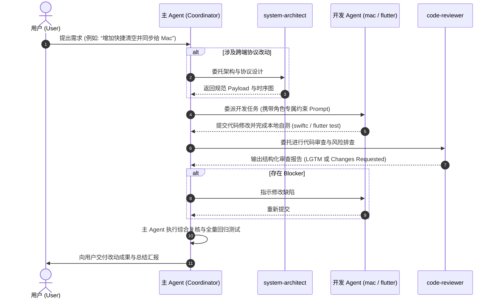

# Vocal 多 Agent 协作体系与子 Agent 目录 (.agents/)

本目录包含 **Vocal** 项目专属的 Agent 团队设定与协同技能体系。
项目采用 **Hub & Spoke（总控协调 + 垂直领域专家）** 架构：
- **主 Agent (你 / Coordinator)**：负责接收用户指令、拆解需求、委派任务给具体领域的子 Agent，并在子 Agent 提交成果后担任**审查官 (Reviewer)**，执行最终的代码复核、端到端测试与质量把关。
- **4 位专业子 Agent**：各自深耕垂直领域，确保单点任务高精度、零违规落地。

---

## 1. 目录结构

```text
.agents/
├── README.md                          # [本文档] 团队协作总览与规范
├── agents/                            # 各垂直领域 Agent 独立设定
│   ├── mac-host-dev.md                # 🍎 macOS 宿主端开发专家 (Swift / Accessibility / NWListener)
│   ├── flutter-mobile-dev.md          # 📱 Flutter/iOS 移动端开发专家 (Dart / STT / nsd / WebSocket)
│   ├── system-architect.md            # 📐 系统架构与低延迟通信协议专家
│   └── code-reviewer.md               # 🛡️ 代码审查与质量门禁专家
└── skills/
    └── vocal-agents/
        ├── SKILL.md                   # 🚀 多 Agent 编排与调用技能标准
        └── references/
            ├── communication-protocol.md # 📡 双端 WebSocket 协议与心跳机制规范
            └── critical-rules.md         # ⚠️ 致命避坑与开发铁律检查清单
```

---

## 2. Agent 角色分工速查表

| Agent 标识 | 角色名 | 核心职责 | 专属文件与工具 | 核心避坑红线 |
| :--- | :--- | :--- | :--- | :--- |
| **`mac-host-dev`** | macOS 宿主专家 | `mac/VocalHostApp.swift`、Network.framework WebSocket Server、Bonjour NetService、Accessibility CGEvent 字符与回车注入、DMG 打包 | `mac/` 目录、`swiftc`、`mac/build_macos.sh` | 保持纯 Swift 零外部依赖；严格处理后台网络线程与主线程注入安全；健全处理 Accessibility 权限缺失。 |
| **`flutter-mobile-dev`** | Flutter 移动端专家 | `mobile/` 源码、SFSpeechRecognizer 本地语音转录、nsd mDNS 服务扫描、WebSocket 长连接重连与心跳、草稿缓冲与回车控制 | `mobile/lib/`、`fvm flutter`、`mobile/test/` | **iOS 26 真机严禁 Debug 模式**（必须 `--profile` 运行）；恪守“草稿不自动发送”原则；保持 Controller 与 UI 解耦。 |
| **`system-architect`** | 系统架构与协议专家 | 全链路极低延迟（<50ms）设计、双端通信协议制定、心跳与重连时序图、扩展特性（PIN码/加密）设计 | `communication-protocol.md`、Mermaid 序列图与状态机 | 坚守向后兼容性（Mac 端必须兜底纯文本）；杜绝单向破坏性协议变更。 |
| **`code-reviewer`** | 代码审查与质量守门员 | 审查所有 PR/Diff；核查协议兼容性、iOS 26 真机防崩溃命令、权限防御、Timer/资源泄漏与测试覆盖率 | 代码审查 Checklist、结构化 Review 报告 | 严查 Blocker 问题，未修复前坚决驳回；督促单测覆盖。 |
| **主 Agent (Coordinator)** | 总控编排者与首席审查官 | 需求调度分发、多 Agent 流程串联、复核子 Agent 改动、执行自动化验证、最终交付整合 | `invoke_subagent` 编排、最终汇报 | 对整个交付结果负终极责任，确保系统稳定可靠。 |

---

## 3. 工作流执行流程 (Hub & Spoke)



---

## 4. 关键规则文档链接
- [双端通信与 WebSocket 协议标准规范 (communication-protocol.md)](./skills/vocal-agents/references/communication-protocol.md)
- [致命避坑与开发铁律检查清单 (critical-rules.md)](./skills/vocal-agents/references/critical-rules.md)
- [Vocal 多 Agent 协同与任务编排技能 (SKILL.md)](./skills/vocal-agents/SKILL.md)

