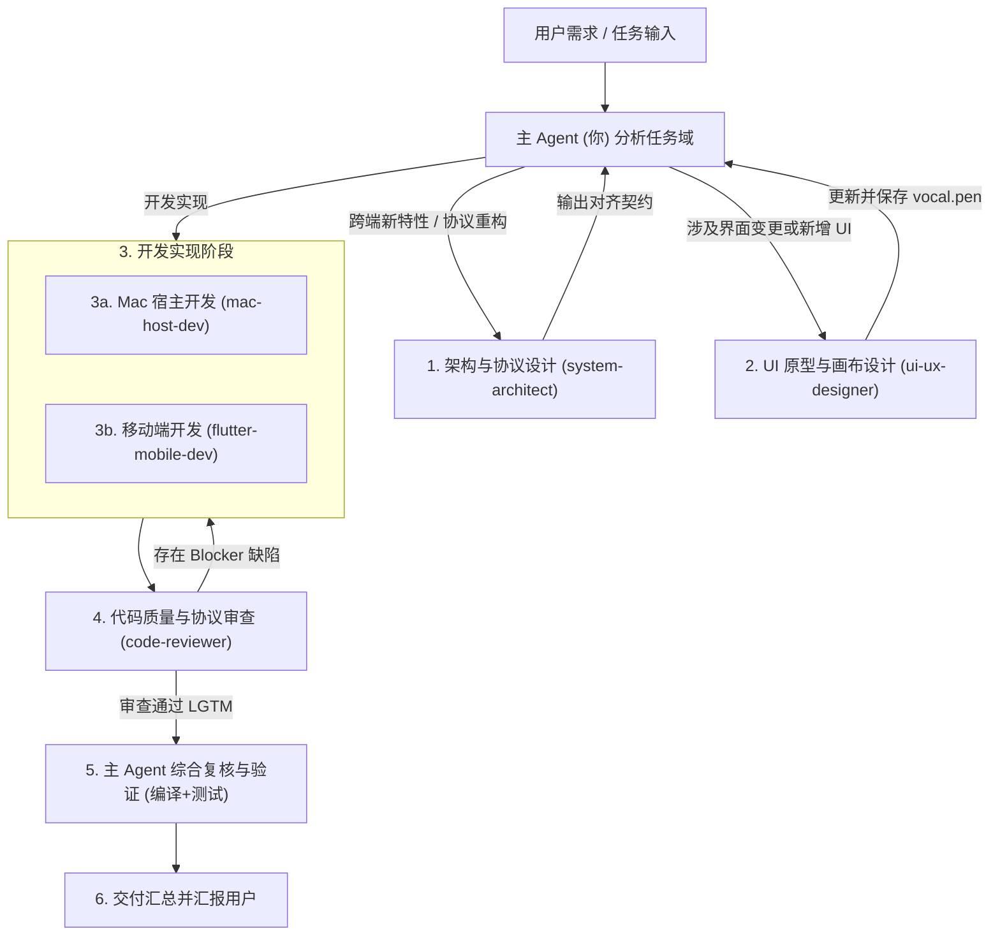

# Vocal 多 Agent 协同与任务编排技能 (vocal-agents)

本技能为 **Vocal（基于 iPhone 的 Mac 高速语音录入键盘）** 项目提供标准化、模块化的多 Agent 协作工作流。

采用**总分结合（Hub & Spoke）**架构：
- **主 Agent (Coordinator / Lead Reviewer)**：负责接收用户需求、识别任务域、任务分发给专业子 Agent，并在子 Agent 完成后对其改动进行全面代码审查、测试验证与最终整合。
- **5 个专业子 Agent (Spokes)**：各司其职，专注各自领域的深度实现与优化。

---

## 1. 团队 Agent 角色矩阵

| Agent 标识 | 角色名称 | 核心职责 | 对应领域与文件 | 独立设定文件 |
| :--- | :--- | :--- | :--- | :--- |
| **`system-architect`** | 系统架构与协议专家 | 全链路低延迟控制、mDNS 发现拓扑、WebSocket JSON 契约、双端状态机、扩展功能设计 | 跨端架构、协议规范、状态流转 | [`agents/system-architect.md`](file:///Users/idcpj/workspace/vocal/.agents/agents/system-architect.md) |
| **`ui-ux-designer`** | UI/UX 视觉与组件专家 | `vocal.pen` 画布维护、极简暗黑科技风规范、新功能交互原型、可复用 pen 组件抽象沉淀与多端 UI 状态画板同步 | `vocal.pen`、`pencil` MCP 工具链 (`get_app_state`, `execute`, `save`) | [`agents/ui-ux-designer.md`](file:///Users/idcpj/workspace/vocal/.agents/agents/ui-ux-designer.md) |
| **`mac-host-dev`** | macOS 宿主开发专家 | 8888 端口 NWListener WebSocket Server、NetService 广播、Accessibility CGEvent 字符及回车注入、无 Dock 常驻菜单栏、DMG 构建 | `mac/VocalHostApp.swift`, `mac/build_macos.sh`, `mac/Info.plist` | [`agents/mac-host-dev.md`](file:///Users/idcpj/workspace/vocal/.agents/agents/mac-host-dev.md) |
| **`flutter-mobile-dev`** | Flutter 移动端开发专家 | SFSpeechRecognizer 本地听写与草稿累加、nsd 局域网服务发现、WebSocket 客户端重连与心跳、暗黑科技风动效、真机 Profile 调试 | `mobile/lib/`, `mobile/pubspec.yaml`, `mobile/test/` | [`agents/flutter-mobile-dev.md`](file:///Users/idcpj/workspace/vocal/.agents/agents/flutter-mobile-dev.md) |
| **`code-reviewer`** | 代码审查与质量门禁专家 | Swift/Dart 规范审计、双端协议兼容性审查、iOS 26 真机运行规约排查、Accessibility 权限与异常防护审计、阻断项把控 | 全局改动 PR、Diff 与自动化测试审计 | [`agents/code-reviewer.md`](file:///Users/idcpj/workspace/vocal/.agents/agents/code-reviewer.md) |
| **主 Agent** *(You / Coordinator)* | 总控协调者与审查负责人 | 需求解析、子 Agent 调度分发、改动综合审查、测试回归执行、统一向用户汇报 | 全局编排与最终交付 | 本文档与 `AGENTS.md` |

---

## 2. 团队协作标准工作流 (Workflow)



### 步骤 1：需求分析与架构对齐（涉及跨端新特性时）
- 当需求涉及跨端协议（如加密、PIN 配对、新的控制指令）时，主 Agent 唤醒 `system-architect`；
- 输出契约定义（见 [`communication-protocol.md`](./references/communication-protocol.md)），明确 JSON Payload 格式与双向兼容策略。

### 步骤 2：UI 原型设计与组件沉淀（涉及界面变动时）
- 当需求涉及新功能界面新增、布局变更或交互状态更新时，主 Agent 唤醒 `ui-ux-designer`；
- 读取 [`agents/ui-ux-designer.md`](file:///Users/idcpj/workspace/vocal/.agents/agents/ui-ux-designer.md) 专属设定，使用 `pencil` MCP 工具分析画板与已有组件；
- **组件抽象与复用**：若发现具有通用复用价值的 UI 元素（按钮、Badge、弹窗、输入项等），优先抽取为 pen 原生组件（`reusable: true`），在各画板中通过实例（`type: "ref"`）引用并覆盖属性；
- 使用 `pencil/save` 落地保存 `vocal.pen`，为后续 Flutter / Mac 开发提供精确的设计对照。

### 步骤 3：专业子 Agent 独立开发
- **修改 Mac 端**：主 Agent 读取 [`agents/mac-host-dev.md`](file:///Users/idcpj/workspace/vocal/.agents/agents/mac-host-dev.md) 的专属设定，委派给 `mac-host-dev`。子 Agent 完成后本地编译 `swiftc` 校验。
- **修改 Flutter 端**：主 Agent 读取 [`agents/flutter-mobile-dev.md`](file:///Users/idcpj/workspace/vocal/.agents/agents/flutter-mobile-dev.md) 的专属设定，委派给 `flutter-mobile-dev`。子 Agent 遵循真机 Profile 模式与 Controller/UI 解耦原则，执行 `fvm flutter test` 校验。

### 步骤 4：代码审查门禁 (Code Review)
- 子 Agent 提交代码后，主 Agent 唤醒 `code-reviewer`，对 Diff 执行严格把关：
  1. 是否破坏了向下兼容？
  2. 是否遵循了 iOS 26 真机严禁 Debug 的铁律？
  3. 是否处理了 Accessibility 权限检查与多线程安全？
  4. 是否存在 Timer 或长连接内存泄漏？

### 步骤 5：主 Agent 最终复核与整合
- 主 Agent 复核 `code-reviewer` 的审查报告；
- 确认自动化测试与编译无误后，完成改动合入，并向用户提供清晰的交付说明。

---

## 3. 按需唤醒与调用示例 (Invocation Templates)

主 Agent 调度子 Agent 时，建议使用 `invoke_subagent` 工具并附带其对应的职责 Prompt。

### 示例 1：调度 `mac-host-dev` 修改 Mac 宿主
```json
{
  "TypeName": "self",
  "Role": "macOS Host Developer",
  "Prompt": "你当前扮演【macOS 宿主端开发专家 (mac-host-dev)】。\n请严格遵循 .agents/agents/mac-host-dev.md 的开发规约。\n任务：修改 mac/VocalHostApp.swift，优化状态栏图标在 iPhone 断开连接时的红点提示状态，并确保网络断开时安全注销 NWConnection 句柄。\n注意：完成修改后在终端运行 swiftc 语法编译检查，保持单文件无外部依赖。"
}
```

### 示例 2：调度 `flutter-mobile-dev` 修改移动端
```json
{
  "TypeName": "self",
  "Role": "Flutter Mobile Developer",
  "Prompt": "你当前扮演【Flutter/iOS 移动端开发专家 (flutter-mobile-dev)】。\n请严格遵循 .agents/agents/flutter-mobile-dev.md 的开发规约。\n任务：在 mobile/lib/page/vocal_home_screen.dart 中增加一个清空草稿按钮，并在 vocal_home_controller.dart 中实现对应的 clearDraft() 逻辑。\n注意：保持 Controller 与 UI 解耦，恪守本地草稿不自动发送原则，并在 mobile/ 运行 fvm flutter test 确保测试通过。"
}
```

### 示例 3：调度 `system-architect` 设计新功能协议
```json
{
  "TypeName": "self",
  "Role": "System Architect",
  "Prompt": "你当前扮演【系统架构与通信协议专家 (system-architect)】。\n请严格遵循 .agents/agents/system-architect.md 的架构原则。\n任务：设计支持“多 Mac 局域网广播与手动 PIN 码首次配对”的扩展通信协议，包含 mDNS TXT Record 扩展、WebSocket 鉴权握手时序图与双端向后兼容降级策略。"
}
```

### 示例 4：调度 `code-reviewer` 进行改动审查
```json
{
  "TypeName": "self",
  "Role": "Code Reviewer",
  "Prompt": "你当前扮演【代码审查与质量门禁专家 (code-reviewer)】。\n请严格遵循 .agents/agents/code-reviewer.md 的审查清单。\n任务：审查当前 Git 工作区内针对 mac/VocalHostApp.swift 和 mobile/ 的最新代码修改。\n重点检查：双端协议向后兼容性、iOS 26 真机调试命令合规性、Accessibility 权限防御与 Timer 泄漏情况，并输出标准 Review 报告。"
}
```

### 示例 5：调度 `ui-ux-designer` 更新 vocal.pen 设计画板与沉淀组件
```json
{
  "TypeName": "self",
  "Role": "UI/UX Designer",
  "Prompt": "你当前扮演【UI/UX 设计与视觉原型专家 (ui-ux-designer)】。\n请严格遵循 .agents/agents/ui-ux-designer.md 的设计规范与组件复用铁律。\n任务：为 Vocal 新增功能（如设备首次 PIN 码配对弹窗）在 vocal.pen 画布中设计高保真画板。\n注意：\n1. 严禁直接文本编辑 .pen 文件，必须使用 pencil MCP 工具（get_app_state, execute, save）；\n2. 凡可复用的 UI 模式（按钮、Badge、弹窗卡片等），主动抽象为 pen 原生组件 (reusable: true)，在业务画板中以 ref 实例引用；\n3. 沿用暗黑科技风设计规范与 vocal_ui_kit 组件，完成修改后调用 save 保存。"
}
```

---

## 4. 关键规约参考文档
- [双端通信与 WebSocket 协议标准规范 (communication-protocol.md)](./references/communication-protocol.md)
- [跨端自动化集成测试架构规范 (e2e-testing-architecture.md)](./references/e2e-testing-architecture.md)
- [致命避坑与开发铁律检查清单 (critical-rules.md)](./references/critical-rules.md)

