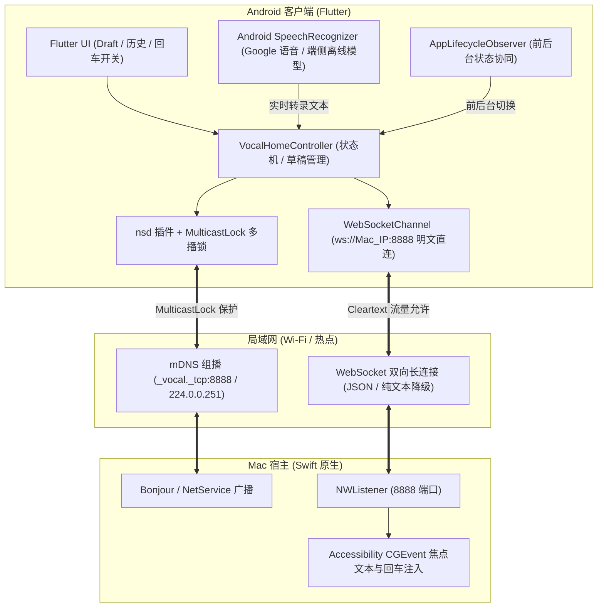
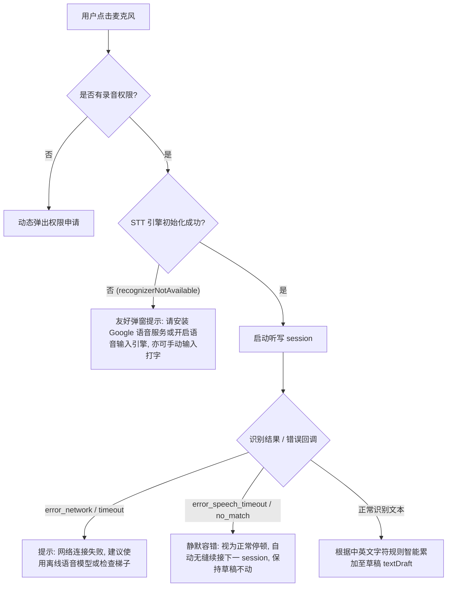
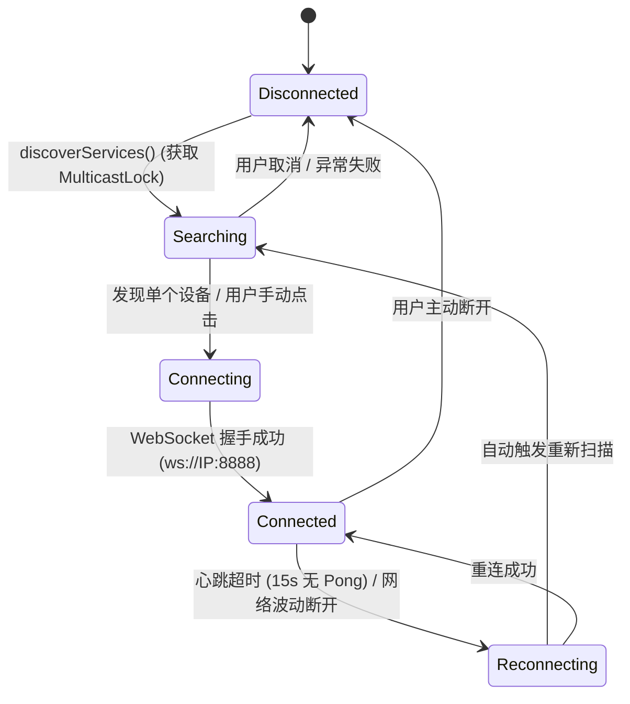

# Vocal Android 客户端技术架构与落地规范 (Android Mobile Architecture & Implementation Spec)

> **版本**: 1.0.0  
> **责任专家**: `system-architect` (系统架构与通信协议专家)  
> **面向对象**: `flutter-mobile-dev`, `code-reviewer`, 主 Agent  
> **适用范围**: `mobile/` 目录中 Android 平台相关编译、权限、局域网通信、语音引擎与状态机实现

---

## 1. 架构目标与技术全景

### 1.1 适配目标
将 Vocal 原生低延迟输入体验扩展至 Android 平台，兼容主流 Android 8.0 ~ Android 14+ (API 26 ~ 34+) 设备，覆盖原生 Android (Pixel 等搭载 Google 服务) 以及中国大陆主流定制 ROM (小米 HyperOS/MIUI、华为 HarmonyOS/EMUI、OPPO ColorOS、vivo OriginOS 等无 GMS 环境)。

### 1.2 端到端通信拓扑



---

## 2. AndroidManifest.xml 权限与清单规范

### 2.1 权限清单详解与底层原理

在 Android 系统中，网络与硬件调用存在严格的安全沙箱和省电限制，缺少任何一项均会导致底层抛出未捕获异常。

| 权限标识 | 权限级别 | 核心作用与源码级因果关系 |
| :--- | :--- | :--- |
| `android.permission.RECORD_AUDIO` | **危险权限** (运行时) | 麦克风录音权限。`SpeechToText` 初始化和录音的法定前置条件，未授权将导致 `initialize()` 失败。 |
| `android.permission.INTERNET` | 普通权限 | 建立 TCP 原始 Socket 与 WebSocket 直连 (`ws://<Mac_IP>:8888`)。 |
| `android.permission.ACCESS_NETWORK_STATE` | 普通权限 | 感知网络连接状态（Wi-Fi 是否连通、局域网 IP 变化）。 |
| `android.permission.ACCESS_WIFI_STATE` | 普通权限 | 查询 Wi-Fi 芯片状态与网卡 IP 分配情况。 |
| `android.permission.CHANGE_WIFI_MULTICAST_STATE` | 普通权限 | **【核心铁律】** Wi-Fi 芯片组播过滤开关。<br>在 `nsd_android` 插件的 `NsdAndroidPlugin.kt` 第 89-94 行显式校验：<br>`if (multicastLock == null) throw NsdError(SECURITY_ISSUE, "Missing required permission CHANGE_WIFI_MULTICAST_STATE")`<br>若未声明，调用 `startDiscovery()` 会直接崩溃或抛出异常。 |
| `android.permission.WAKE_LOCK` | 普通权限 | 允许在屏幕变暗或用户打字时保持 CPU 轻度运转，防止系统深度休眠切断 WebSocket 心跳或中断长语音识别。 |
| `android.permission.BLUETOOTH_CONNECT` | 危险权限 (API 31+) | 支持蓝牙耳机/麦克风录音输入。针对 Android 12+ 需按需动态申请，若不使用蓝牙可通过参数忽略。 |

---

### 2.2 明文网络流量配置 (Cleartext Traffic)

#### 问题根因剖析
- Android 9 (API 28) 起，系统网络安全策略默认**全面禁止明文 HTTP/WebSocket (`http://`, `ws://`) 传输**。
- Vocal 的宿主端运行在局域网内，采用轻量级 `ws://<Mac_IP>:8888` 协议，没有公网 CA 证书（无法使用 `wss://`）。
- 若未显式配置明文传输许可，Android 系统在执行 `WebSocketChannel.connect(Uri.parse('ws://...'))` 时，底层 OkHttp / HttpURLConnection 会直接阻断连接并抛出致命异常：  
  `java.io.IOException: Cleartext HTTP traffic to 192.168.x.x not permitted`。

#### 解决方案
在 `<application>` 节点显式增加属性：
```xml
<application
    ...
    android:usesCleartextTraffic="true">
```

> [!NOTE]
> 如果项目未来需要通过 Google Play 严格安全审查，可改用 `android:networkSecurityConfig="@xml/network_security_config"`，在 XML 中单独白名单放行局域网私网网段 (`192.168.0.0/16`, `10.0.0.0/8`, `172.16.0.0/12`)。现阶段推荐直接使用 `android:usesCleartextTraffic="true"` 确保全网段兼容。

---

### 2.3 Android 11+ (API 30+) 软件包可见性与 `<queries>` 声明

#### 问题根因剖析
- Android 11 引入了**软件包可见性 (Package Visibility)** 机制。应用无法直接查询系统未导出的其他应用或系统服务组件。
- `speech_to_text` 在 Android 端的底层实现为 `android.speech.SpeechRecognizer`。在初始化检查 `SpeechRecognizer.isRecognitionAvailable(context)` 时，系统底层通过 PackageManager 查询能够处理 `android.speech.RecognitionService` 意图的服务。
- 若没有在 `AndroidManifest.xml` 中加入 `<queries>`，查询结果将返回空，导致：
  ```kotlin
  if (!SpeechRecognizer.isRecognitionAvailable(localContext)) {
      Log.e(logTag, "Speech recognition not available on this device")
      activeResult?.error(SpeechToTextErrors.recognizerNotAvailable.name, ...)
  }
  ```
  在 Android 11+ 设备上应用直接判定语音识别不可用！

#### 解决方案
在 `<manifest>` 根节点下声明 `<queries>`：
```xml
<queries>
    <!-- 显式声明系统级语音识别服务意图，确保 isRecognitionAvailable 准确识别 -->
    <intent>
        <action android:name="android.speech.RecognitionService" />
    </intent>
    <!-- Flutter 引擎自带文本处理插件 -->
    <intent>
        <action android:name="android.intent.action.PROCESS_TEXT" />
        <data android:mimeType="text/plain" />
    </intent>
</queries>
```

---

### 2.4 标准 `AndroidManifest.xml` 参考落地模板

```xml
<manifest xmlns:android="http://schemas.android.com/apk/res/android">

    <!-- 1. 硬件录音权限 (运行时请求) -->
    <uses-permission android:name="android.permission.RECORD_AUDIO" />

    <!-- 2. 网络与套接字权限 -->
    <uses-permission android:name="android.permission.INTERNET" />
    <uses-permission android:name="android.permission.ACCESS_NETWORK_STATE" />
    <uses-permission android:name="android.permission.ACCESS_WIFI_STATE" />

    <!-- 3. mDNS 局域网组播必须权限 -->
    <uses-permission android:name="android.permission.CHANGE_WIFI_MULTICAST_STATE" />

    <!-- 4. CPU 保活防止长连接/长录音意外中断 -->
    <uses-permission android:name="android.permission.WAKE_LOCK" />

    <!-- 5. 蓝牙耳机麦克风支持 (Android 12+) -->
    <uses-permission android:name="android.permission.BLUETOOTH_CONNECT" />

    <!-- 6. Android 11+ 软件包可见性白名单声明 -->
    <queries>
        <intent>
            <action android:name="android.speech.RecognitionService" />
        </intent>
        <intent>
            <action android:name="android.intent.action.PROCESS_TEXT" />
            <data android:mimeType="text/plain" />
        </intent>
    </queries>

    <application
        android:label="vocal"
        android:name="${applicationName}"
        android:icon="@mipmap/ic_launcher"
        android:usesCleartextTraffic="true">
        
        <activity
            android:name=".MainActivity"
            android:exported="true"
            android:launchMode="singleTop"
            android:taskAffinity=""
            android:theme="@style/LaunchTheme"
            android:configChanges="orientation|keyboardHidden|keyboard|screenSize|smallestScreenSize|locale|layoutDirection|fontScale|screenLayout|density|uiMode"
            android:hardwareAccelerated="true"
            android:windowSoftInputMode="adjustResize">
            <meta-data
              android:name="io.flutter.embedding.android.NormalTheme"
              android:resource="@style/NormalTheme" />
            <intent-filter>
                <action android:name="android.intent.action.MAIN"/>
                <category android:name="android.intent.category.LAUNCHER"/>
            </intent-filter>
        </activity>
        
        <meta-data
            android:name="flutterEmbedding"
            android:value="2" />
    </application>
</manifest>
```

---

## 3. 局域网服务发现 (mDNS & NSD) 兼容调优与容灾

### 3.1 MulticastLock 机制与生命周期
1. **多播包过滤原理**:
   - 绝大多数 Android 手机厂商为延长电池寿命，在 Wi-Fi 芯片固件层面配置了硬件过滤器（Hardware Multicast Filtering），默认丢弃所有组播包（IPv4 `224.0.0.0/4`，包括 mDNS 的 `224.0.0.251:5353`）。
2. **锁的获取与释放**:
   - 依赖 `nsd: ^4.1.0` 插件，在调用 `nsd.startDiscovery('_vocal._tcp')` 时底层由 `NsdAndroidPlugin` 自动调用 `multicastLock?.acquire()`；
   - 在连接成功或用户离开发现页面时，**必须显式调用 `stopDiscovery()`**，防止 `MulticastLock` 长期持有导致设备异常发热与电量消耗。
3. **国产 ROM 后台休眠防御**:
   - 小米 HyperOS、华为 HarmonyOS 等在屏幕熄灭或切入后台时，可能会自动剥夺 MulticastLock；
   - 规范要求：在应用返回前台（`AppLifecycleState.resumed`）时，检查当前连接状态。若连接已丢失，立即自动触发新一轮 `discoverServices()` 重新拉起锁与扫描。

### 3.2 AP 隔离与企业网 mDNS 屏蔽容灾 (Manual Connect)
- **场景痛点**:
  在大型公司办公 Wi-Fi、大学校园网或开启了“AP 隔离 / 客户端隔离”的路由器中，路由器会主动丢弃组播帧，手机端无法通过 mDNS 搜到 Mac。
- **架构解法**:
  - `VocalHomeController` 已具备 `connectDirect(String host, int port)` 底层支持；
  - 移动端在扫描状态持续超过 6 秒且未搜到设备时，在界面上显式提供 **“手动输入 Mac IP 连接”** 入口（例如弹窗输入 `192.168.1.100`，端口默认 `8888`），直连 WebSocket，彻底打破 AP 隔离壁垒。

---

## 4. Android SpeechRecognizer 引擎深度调优与容灾方案

### 4.1 国内无 GMS 生态与 Google 语音服务依赖

#### 现状与风险
- 原生 Android 系统（Pixel 等）内置 Google 语音识别服务 (`com.google.android.googlequicksearchbox`)。
- 国内主流手机（小米、华为、OPPO、vivo、荣耀等）绝大多数未预装 Google 语音服务，部分厂商甚至不提供系统级 `RecognitionService`。
- 此外，即使用户安装了 Google 语音服务，由于中国大陆境内无法直连 Google 语音服务器，在默认在线识别模式下会持续上报 `error_network` 或 `error_network_timeout`。

#### 四级容灾阶梯机制



---

### 4.2 错误码标准映射与友好交互表

| Android 错误码常量 | 插件错误字符串 | 场景说明 | 业务层处理策略 |
| :--- | :--- | :--- | :--- |
| `ERROR_AUDIO` (3) | `error_audio_error` | 录音硬件被电话、相机或其他应用占用 | Toast 提示“麦克风被其他应用占用，请重试” |
| `ERROR_CLIENT` (5) | `error_client` | 客户端内部状态异常 | 延时 200ms 重置引擎，不打扰用户 |
| `ERROR_NETWORK` (2)<br>`ERROR_NETWORK_TIMEOUT` (1) | `error_network`<br>`error_network_timeout` | 无法连接 Google 语音识别服务器（国内常见） | 提示“语音识别联网失败，请检查网络或在 Google 设置中下载离线语言包” |
| `ERROR_NO_MATCH` (7) | `error_no_match` | 没有在声音中识别出有效词句 | **【静音容灾】** 视为自然停顿，不报错，不打扰，自动续接 |
| `ERROR_SPEECH_TIMEOUT` (6) | `error_speech_timeout` | 用户暂停说话超过 1~2 秒 | **【平滑续接】** 视为一句话结束，自动续接开启下一句，草稿不丢 |
| `ERROR_RECOGNIZER_BUSY` (8) | `error_busy` | 上一次识别会话未完全销毁 | 延时 150ms 重新调用 `_beginListenSession()` |
| `SpeechToTextErrors.recognizerNotAvailable` | - | 系统完全缺少语音识别服务 | 弹窗引导安装 Google 语音服务，并推荐使用手动打字 |

---

### 4.3 Android 持续长语音听写 (Continuous Dictation) 体验打磨

#### 平台差异核心痛点
- **iOS 表现**: `SFSpeechRecognizer` 支持长达数分钟的连续流式转录；
- **Android 表现**: 原生 `SpeechRecognizer` 偏向语音指令交互，用户稍有 1~2 秒停顿，引擎便会触发 `onEndOfSpeech()` 并抛出 `error_speech_timeout` 或 `error_no_match`，进而派发 `status = done`。

#### 连续听写算法规范
1. **意图锚定 (`_wantsListening`)**:
   - 只有用户点击“录音中 · 点击停止”或点击“发送”时，`_wantsListening` 才置为 `false`。
   - 任何由于系统超时、无匹配等触发的 `done` 状态，均**不得**将 `_wantsListening` 改为 `false`。
2. **草稿隔离安全累加 (`_combineBaseAndSpoken`)**:
   - 每一轮识别完成时，将识别到的临时文字（`_currentSessionWords`）提交到基准草稿（`_sessionBaseText`），并清空 `_currentSessionWords`；
   - 重新进入新 session 时，从新 session 开始累加，杜绝因为会话重启导致之前的文字被覆盖或清空。
3. **自愈防抖重启**:
   ```dart
   if (status == 'done' && _wantsListening) {
     Future.delayed(const Duration(milliseconds: 150), () {
       if (_wantsListening && !_speechToText.isListening && !_isStartingSession) {
         debugPrint('Android STT: Smooth session auto-restart...');
         _beginListenSession();
       }
     });
   }
   ```
4. **离线语音优化 (On-Device Speech Recognition)**:
   - Android 13+ (API 33+) 引入了端侧离线识别 API (`createOnDeviceSpeechRecognizer`)。
   - 在已下载离线语言包的 Android 设备上，开启 `onDevice: true` 能够实现 0 网络依赖、极低延迟的语音转写，完全规避网络报错。

---

### 4.4 语言列表 (Locales) 容灾

- **Android 机制**: Android 端通过向系统发送广播 `RecognizerIntent.ACTION_GET_LANGUAGE_DETAILS` 获取支持的语言列表。在没有安装 Google 语音服务的手机上，该广播可能无任何响应，导致 `_speechToText.locales()` 返回空列表 `[]`。
- **降级规范**:
  若 `locales` 返回为空，Controller 必须注入默认的常用语言列表作为兜底（中文 `zh_CN`、英文 `en_US`），保证语言切换弹窗正常可用，避免空白页面。

---

## 5. 双端系统状态机与生命周期对齐

### 5.1 完整连接状态机



### 5.2 前后台生命周期协同规范 (`AppLifecycleListener`)

| App 生命周期事件 | 麦克风录音 (STT) 行为 | 局域网长连接 (WebSocket) 行为 |
| :--- | :--- | :--- |
| `AppLifecycleState.paused` (退到后台) | **必须主动停止录音** (`stopListening()`)，防止后台占用麦克风导致系统强杀或隐私提示。草稿完整保留。 | 保持 WebSocket 监听。如果在后台被系统切断，标记状态为断开。 |
| `AppLifecycleState.resumed` (回到前台) | 保持空闲状态，等待用户再次点击录音。草稿完好无损。 | **即时存活自检**: 检查 `_isConnected` 与 `_channel`。若已断开，立即自动执行 `discoverServices()` 恢复连接。 |

---

## 6. 给 flutter-mobile-dev 的实施指导与检查清单 (Checklist)

### 步骤一：Gradle 配置核验
- [ ] 检查 `mobile/android/app/build.gradle.kts`：
  - 确认 `compileSdk >= 34`；
  - 确认 `minSdk >= 21`（支持 Android 5.0+）；
  - 确认 `targetSdk >= 34`。

### 步骤二：`AndroidManifest.xml` 更新
- [ ] 在 `<manifest>` 根节点下补充 6 个核心权限：
  - `RECORD_AUDIO`
  - `INTERNET`
  - `ACCESS_NETWORK_STATE`
  - `ACCESS_WIFI_STATE`
  - `CHANGE_WIFI_MULTICAST_STATE` (防崩溃核心)
  - `WAKE_LOCK`
- [ ] 在 `<manifest>` 下添加 `<queries>` 块，声明 `android.speech.RecognitionService`。
- [ ] 在 `<application>` 标签中添加 `android:usesCleartextTraffic="true"`。

### 步骤三：`VocalHomeController` 代码健壮性改造
- [ ] **错误容灾与提示**: 在 `_initSpeech()` 中对 `available == false` 增加错误原因记录，并在 `onError` 中针对 `error_speech_timeout` 和 `error_no_match` 进行静默容错（不弹窗），针对 `error_network` 给出精准友好提示。
- [ ] **Locales 空列表容灾**: 当 `_speechToText.locales()` 返回空时，提供 `[LocaleName('zh_CN', '中文 (中国)'), LocaleName('en_US', 'English (US)')]` 兜底。
- [ ] **Android 连续录音续接**: 确保在 Android 上 `status == 'done'` 时，若 `_wantsListening == true`，自动平滑延时 150ms 重新调用 `_beginListenSession()`。
- [ ] **多播锁与扫描保护**: 确保在 `connectToService` 或 `dispose` 时可靠调用 `stopDiscovery()`，释放多播锁。
- [ ] **手动 IP 连接入口**: 在设备搜索界面或设置弹窗中保留或增强直接输入 IP/端口的功能，保障 AP 隔离环境可用。

### 步骤四：UI 界面与生命周期适配
- [ ] 在 `VocalHomeScreen` 或其 State 中混入 `WidgetsBindingObserver`，实现前后台切换时的录音平滑停止与连接自愈。
- [ ] 更新 `AppStrings`，增加 Android 相关的友好错误提示（如“未找到系统语音识别服务”、“语音网络错误”等）。

### 步骤五：测试矩阵与验收标准
- [ ] **模拟器验证**: 在 Android Studio 模拟器（API 34）上运行，验证权限正常弹出、明文 WebSocket 握手成功、无崩溃。
- [ ] **真机验证**: 在 Android 真机（开启开发者模式）上验证 mDNS 自动发现 Mac、麦克风拾音、文本实时上屏、手动发送与自动回车。
- [ ] **无 GMS / 飞行模式边界验证**: 验证在无网络或无语音服务时的优雅降级提示，UI 不发生假死或 Crash。
