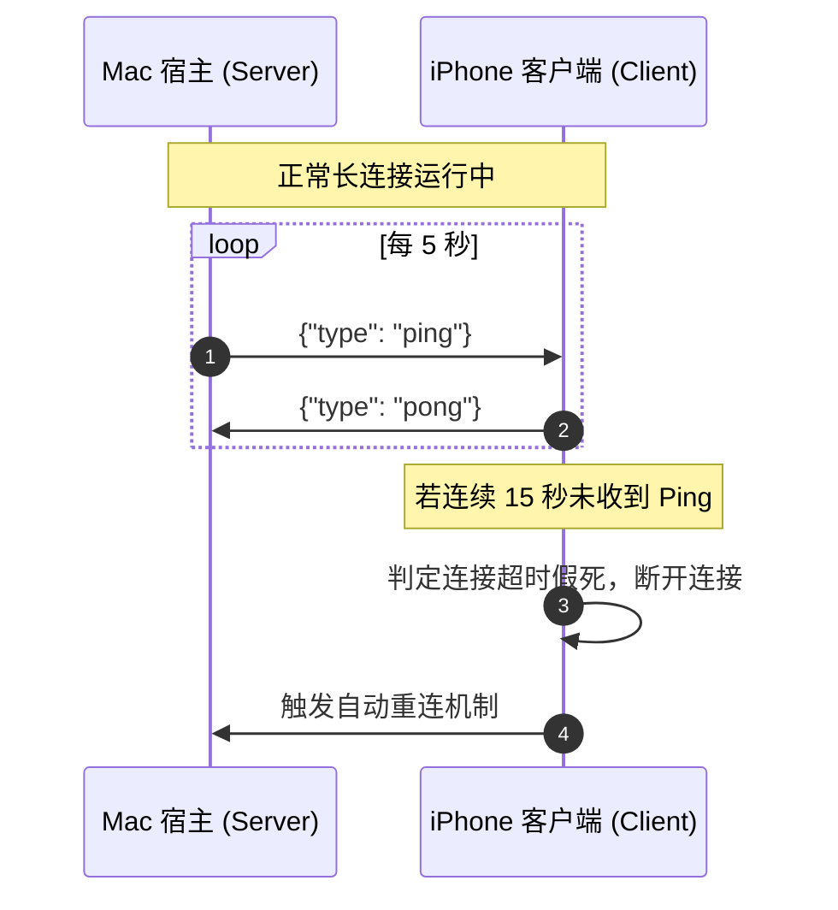
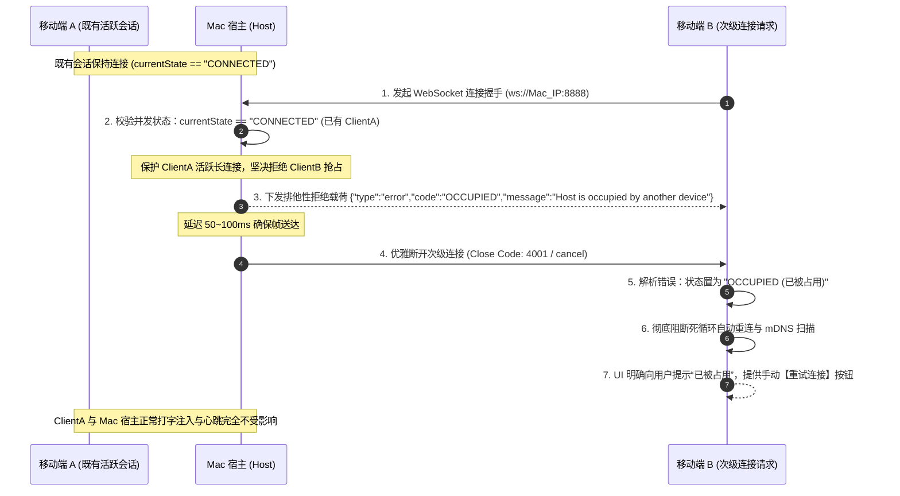
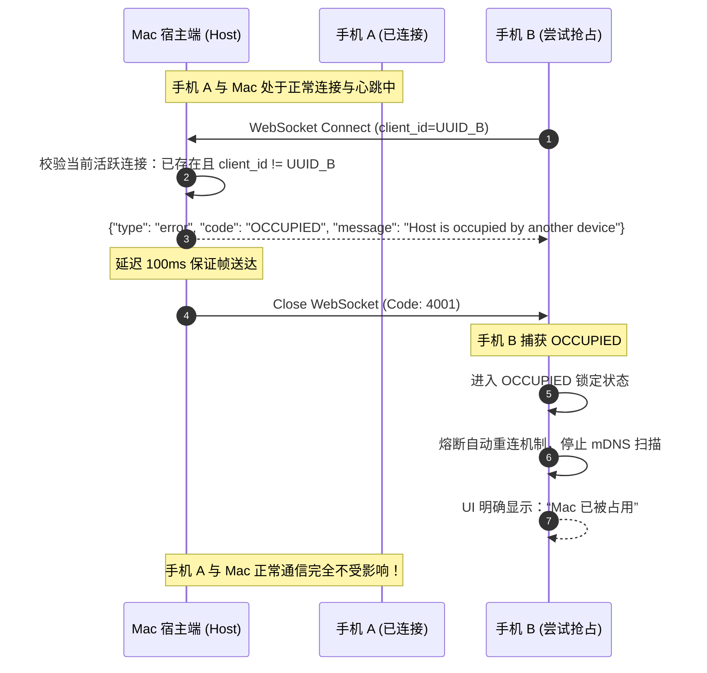
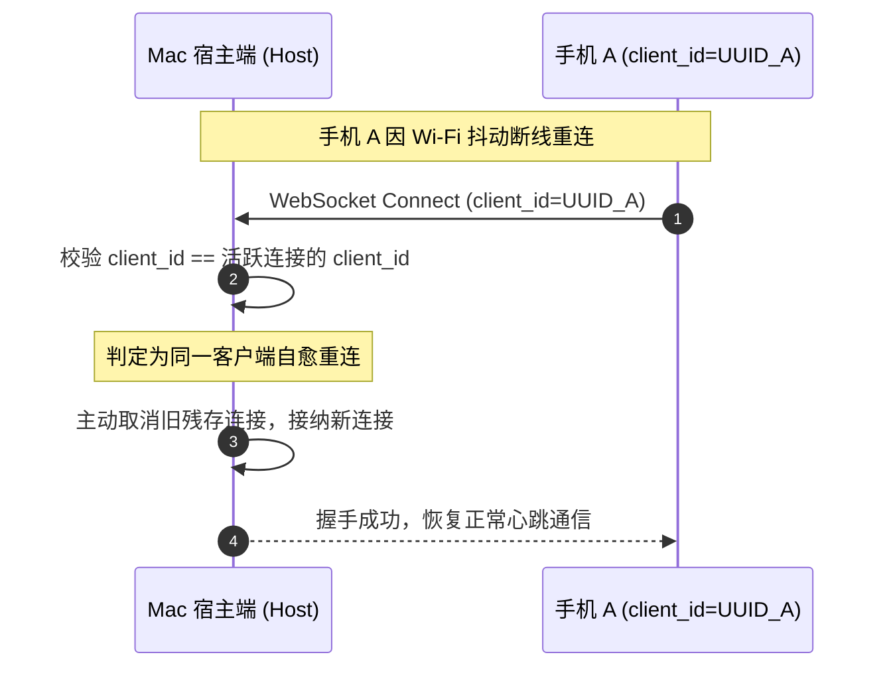
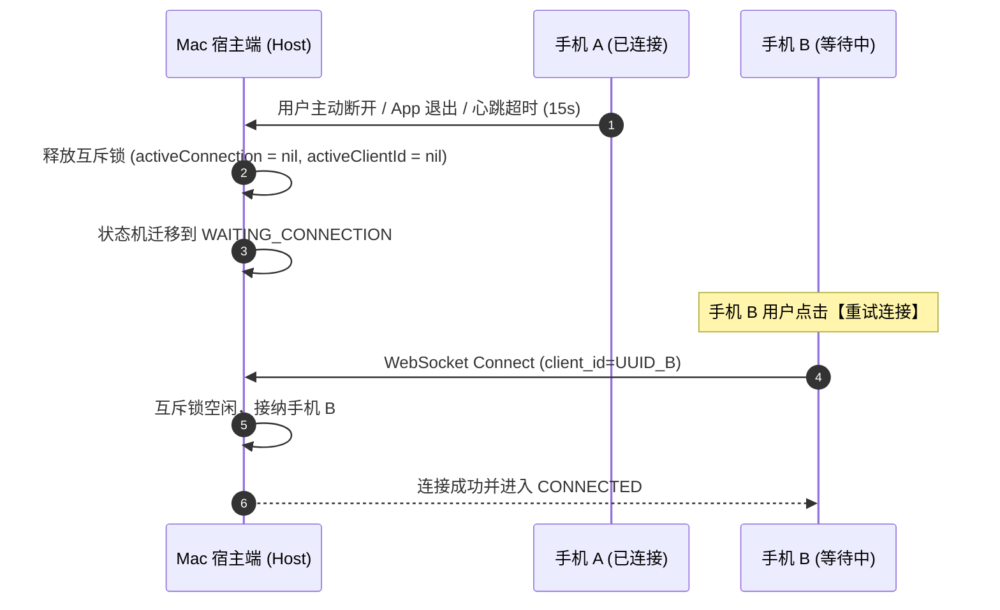
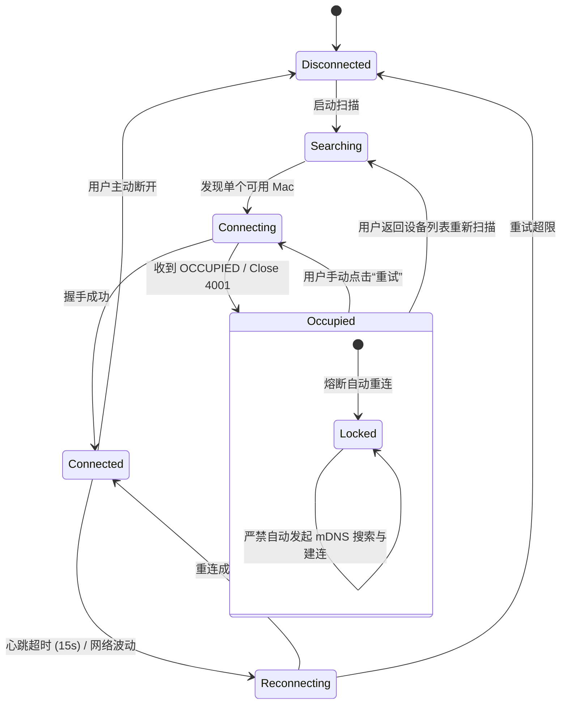

# Vocal 双端通信与 WebSocket 协议标准规范

本文档为 `system-architect`、`mac-host-dev` 与 `flutter-mobile-dev` 的协议唯一真实来源（Single Source of Truth）。任何协议改动必须先修改本文档，经评审后同步修改双端代码。

---

## 1. 基础网络拓扑

```mermaid
graph LR
    subgraph iOS [iOS 客户端 (Flutter)]
        Client[WebSocketClient]
    end

    subgraph Mac [Mac 宿主端 (Swift)]
        Listener[NWListener:8888]
        Bonjour[NetService: _vocal._tcp]
    end

    Bonjour -.->|1. mDNS 广播服务名与端口| Client
    Client ===|2. WebSocket 长连接 (ws://Mac_IP:8888)| Listener
```

- **传输层协议**: WebSocket (`ws://<Mac_IP>:<Port>`)
- **默认端口**: `8888`
- **mDNS 服务类型**: `_vocal._tcp`
- **mDNS 域名**: `local.`
- **编码格式**: UTF-8 文本帧 (Text Frame)

---

## 2. 消息 Payload 契约

### 2.1 文本注入消息 (Client -> Host)

#### 模式 A：结构化 JSON（当前主标准）
```json
{
  "type": "text",
  "text": "你好，这是一段语音转录文字。",
  "pressEnter": true
}
```
- **字段说明**:
  - `type` (string, required): 必须为 `"text"`。
  - `text` (string, required): 需在 Mac 端模拟打字注入的文本内容。支持多字节 UTF-16 Unicode 字符、标点符号、Emoji 及换行符。
  - `pressEnter` (bool, optional, 默认 false):
    - `true`: Mac 端完成全部 Unicode 字符注入后，自动发送一次回车键事件（`kVK_Return`, `0x24`）；
    - `false`: 仅注入文本，不按下回车。

#### 模式 B：纯文本降级（向后兼容）
若 Mac 端接收到的 Payload 无法被解析为 JSON（例如由于早期版本客户端发送纯字符串），Mac 端不得抛出异常断开连接，必须平滑降级：
- 直接将整个原始字符串作为文本注入到焦点窗口；
- 行为等价于 `{"type": "text", "text": payload, "pressEnter": false}`。

---

### 2.2 心跳保活协议 (双向)

为应对 Wi-Fi 休眠、路由器 NAT 超时与局域网网络抖动，双端维护心跳机制：



1. **服务端发 Ping (Host -> Client)**:
   - 触发周期: 每 5 秒
   - 载荷: `{"type": "ping"}`
2. **客户端应答 Pong (Client -> Host)**:
   - 触发时机: 收到 Ping 后立即响应
   - 载荷: `{"type": "pong"}`
3. **超时与重连策略**:
   - 客户端超时阈值: 15 秒（连续 3 次未收到 Ping）；
   - 超时后客户端将 Socket 状态标记为断开，启动去抖重连扫描。

---

### 2.3 设备占用与并发互斥协议 (Host Concurrency & Occupied Error)

在多移动端共存的局域网环境中（如办公区、家庭多设备场景），为防止多个移动端同时或轮流抢占连接导致既有活跃会话被强制中断或输入焦点紊乱，Mac 宿主端实施**单设备独占策略 (Single-Device Exclusive Lease)**。

#### 1. 服务端排他策略 (Host Exclusive Invariant)
Mac 宿主在已有活跃已连接客户端（`currentState == "CONNECTED"` 且底层 WebSocket 通道处于健康就绪状态）时，若收到新的 WebSocket 连接请求，**必须坚决保护既有活跃会话不被中断**。宿主端严禁覆盖或主动断开正在工作的活跃连接，必须对新发起的次级连接发送排他性拒绝载荷。

#### 2. 排他性拒绝 Payload 规范 (Host -> Secondary Client)
```json
{
  "type": "error",
  "code": "OCCUPIED",
  "message": "Host is occupied by another device"
}
```
- **字段说明**:
  - `type` (string, required): 固定为 `"error"`。
  - `code` (string, required): 错误机器识别码，此处固定为 `"OCCUPIED"`。
  - `message` (string, required): 面向客户端日志或提示的人类可读描述，固定为 `"Host is occupied by another device"`。
- **传输层状态码 (WebSocket Close Code)**:
  - 宿主端在下发此 JSON 帧后，建议配合 WebSocket 自定义关闭状态码 `4001` (Host Occupied) 关闭连接。
  - 客户端优先解析收到的 JSON 数据帧，若通道异常断开，亦可根据 Close Code `4001` 进行快速判定。

#### 3. 优雅关闭与客户端防循环策略 (Close Strategy & Loop Breaker)
1. **服务端优雅关闭 (Host Graceful Close)**:
   - Mac 宿主端在向次级连接发送完 `OCCUPIED` JSON 文本帧后，延迟一小段微小时间窗口（建议 50ms~100ms），确保底层 TCP/WebSocket 数据帧被底层网络栈充分 flush 发出，随后主动优雅关闭次级连接（Close Frame 或 `connection.cancel()`），释放次级连接的套接字与线程资源。
   - 整个过程次级连接独立处理，绝不污染或重置宿主的主连接句柄、心跳定时器或状态栏显示。
2. **客户端状态置位与死循环阻断 (Client State & Loop Breaker)**:
   - **状态置位**: 客户端收到 `OCCUPIED` 载荷或 `4001` 关闭码后，将内部连接状态显式迁移为“已被占用”状态（`occupied`）；
   - **阻断自动重连**: 客户端必须彻底阻断死循环自动重连机制（包括 mDNS 自动盲连与心跳断网重试定时器），避免多个被拒绝的设备陷入“被拒 -> 断开 -> 自动重连 -> 再次被拒”的网络广播风暴与高耗电死循环；
   - **UI 提示与用户交互**: 客户端界面状态卡片显示警示信息（如“已被占用”或“当前 Mac 已被其他设备占用”），并提供显式的【重新连接】按钮。只有当用户明确手动点击重新连接时，客户端才允许重新发起建连尝试。

#### 4. 并发互斥交互时序图 (Mermaid)



---

### 2.4 客户端身份标识与握手规范 (Client -> Host)

为了区分“同一设备网络抖动引发的瞬断重连”与“不同设备之间的恶意/意外抢占”，客户端在建立 WebSocket 连接时应携带持久化设备标识：

#### 握手 URL 查询参数
```text
ws://<Mac_IP>:<Port>/?client_id=<DEVICE_UUID>&client_name=<OPTIONAL_DEVICE_NAME>
```
- `client_id` (string, required): 移动端本地持久化生成的 UUID（如 `e4b50c18-971c-4b53-b31a-e669ef07038e`）。在 App 安装周期内保持恒定。
- `client_name` (string, optional, URL 编码): 设备友好名称（如 `iPhone 15 Pro`、`Xiaomi 14`），便于宿主端在菜单栏或日志中精准展示。

---

## 3. 多客户端连接互斥与防抢占规约 (Connection Mutex & Anti-Storm)

### 3.1 核心互斥原则 (Mutual Exclusion Invariant)
1. **单一活跃连接 (Single Active Connection)**:
   Mac 宿主端同一时刻只允许维护一个处于 `ACTIVE` 状态的客户端长连接。
2. **先到先得独占 (First-Come, First-Served)**:
   第一个成功建立 WebSocket 握手的设备获得宿主端通信锁。只要该连接心跳正常，后续任何第三方设备的连接请求必须立即拒绝。
3. **同设备重连识别 (Self-Reconnection Takeover)**:
   若新接入的连接携带的 `client_id` 与当前活跃连接的 `client_id` 相同，宿主判定为**同一设备网络抖动重连**：
   - 宿主主动关闭旧的半开/僵死连接；
   - 立即接纳新连接为活跃连接，避免自阻塞。
4. **非破坏性拒绝 (Non-Destructive Rejection)**:
   拒绝竞争连接时，宿主**严禁断开当前正在工作的活跃连接**。必须对竞争连接发送 `OCCUPIED` 帧后延迟优雅关闭（延迟 50~100ms，确保数据帧刷新到底层网络栈，防止被 TCP RST 冲刷丢弃）。

---

### 3.2 典型通信时序图

#### 场景 1: 多设备竞争连接拒绝与防风暴抑制


#### 场景 2: 同一设备断线自愈重连 (Self Reconnection)


#### 场景 3: 活跃设备主动断开或心跳超时释放互斥锁


---

### 3.3 移动端防风暴抑制策略 (Anti-Storm Circuit Breaker)

当多个客户端处于同一局域网且开启了“自动发现单设备自动连接”时，如果不加抑制，被拒绝的客户端会以极高频率进入 `发现 -> 连接 -> 被拒 -> 重连` 的死循环风暴，耗尽移动端电量并阻塞宿主端事件循环。

移动端必须实施以下熔断策略：



1. **状态机扩充 (`VocalConnectionState.occupied`)**:
   - 当移动端在 WebSocket 通道收到 `{"type":"error","code":"OCCUPIED"}` 或收到 WebSocket 关闭码 `4001` 时，立即迁移到 `occupied` 状态。
2. **彻底切断自动重试 (Hard Break Auto-Retry)**:
   - 处于 `occupied` 状态时，严禁调用 `discoverServices()` 自动寻找设备；
   - 严禁启动任何短周期静默重试定时器；
   - 立即释放或重置底层 `WebSocketChannel`。
3. **UI 引导与恢复路径**:
   - 状态栏与主界面明确提示：“⚠️ Mac 已被占用 (其他设备正在使用)”；
   - 提供显式的【重试连接】按钮或允许用户点击设备选择页面重新选择其他 Mac；
   - 只有经过**明确的人工点击交互**，移动端才允许再次向该 Mac 发起连接请求。

---

### 3.4 宿主端 (Mac Host) 并发互斥实现准则

1. **主线程原子化判定**:
   所有连接状态流转与 `activeConnection` 的读写必须调度在主线程（或同一个专有串行 GCD Queue）中执行，保证判定互斥的原子性（Check-Then-Act 无锁竞态）。
2. **安全下发与延迟清理**:
   ```swift
   // 伪代码参考逻辑
   if let active = self.activeConnection, active.state == .ready {
       if newClientId != nil && newClientId == self.activeClientId {
           // 同一设备重连，替换旧连接
           active.cancel()
           self.activeConnection = newConnection
           self.activeClientId = newClientId
       } else {
           // 冲突连接，发送 OCCUPIED 拒绝载荷
           let errorPayload = "{\"type\":\"error\",\"code\":\"OCCUPIED\",\"message\":\"Host is occupied by another device\"}"
           send(text: errorPayload, to: newConnection)
           // 延迟 100ms 关闭，确保 WebSocket 帧完成底层 TCP flush
           DispatchQueue.main.asyncAfter(deadline: .now() + 0.1) {
               newConnection.cancel()
           }
           return
       }
   }
   ```
3. **僵尸连接自愈 (Zombie Socket Cleanup)**:
   若当前已连接设备意外切断 Wi-Fi，宿主端的心跳监测机制（5s 一次 Ping，配合底层 TCP KeepAlive）在检测到连接失效或超时未回 Pong 时，必须主动将 `activeConnection` 设为 `nil`，确保宿主不会发生死锁（Permanent Latch）。

---

### 2.5 设备安全配对与 PIN 码鉴权协议 (Device Pairing & PIN Auth)

为了在共享局域网（如咖啡厅、共享办公室）保障安全，Mac 宿主端支持可配置的 **PIN 码配对保护门禁**。

#### 1. 握手与鉴权流程 (Handshake Flow)
1. **握手发起 (Client -> Host)**:
   客户端 WebSocket 连接就绪后，立即发送 `auth_request`：
   ```json
   {
     "type": "auth_request",
     "deviceId": "550e8400-e29b-41d4-a716-446655440000",
     "deviceName": "iPhone 15 Pro",
     "token": "stored_token_string_or_empty"
   }
   ```
2. **服务端判定响应 (Host -> Client)**:
   - **模式 A (未启用 PIN 保护)**:
     返回 `{"type": "auth_success", "mode": "open"}`，直接进入鉴权就绪状态；
   - **模式 B (启用保护且 Token 合法)**:
     返回 `{"type": "auth_success", "mode": "trusted"}`，免密秒连；
   - **模式 C (启用保护且未授权或 Token 失效)**:
     返回 `{"type": "auth_require_pin"}`，通知客户端呼起 4 位 PIN 输入界面。
3. **提交 PIN 验证 (Client -> Host)**:
   ```json
   {
     "type": "auth_verify_pin",
     "pin": "8492"
   }
   ```
4. **验证结果判定 (Host -> Client)**:
   - **PIN 正确**:
     生成随机 `token`，加入已信任列表并持久化。
     返回: `{"type": "auth_success", "token": "token_abc123..."}`。
   - **PIN 错误**:
     返回: `{"type": "auth_failed", "reason": "PIN 码错误", "remainingAttempts": 2}`。
     连续 3 次输错后主动断开并冷却 30 秒。

#### 2. 鉴权门禁安全铁律 (Auth Gate Invariant)
在当前连接通过 `auth_success` 之前（未鉴权状态）：
- 服务端**严禁注入任何文本或按键**，所有接收到的 `text` 消息或降级纯文本必须拦截丢弃；
- 若收到 `text` 指令且未鉴权，服务端回送 `{"type": "auth_require_pin"}`；
- 只有成功收到 `auth_success` 后，文本注入通道方可开启。

---

## 4. 局域网异常处理指南
1. **AP 隔离 (Access Point Isolation)**:
   - 某些路由器会阻止同一 Wi-Fi 内的设备直接互相访问。
   - 当 mDNS 扫描持续超时时，客户端应在界面提供明确提示：“请检查路由器是否开启了 AP 隔离 / 访客网络隔离”。
2. **多网卡与 IP 漂移**:
   - 当 Mac 切换 Wi-Fi 或开启热点时，NetService 会动态重新注册广播；
   - 客户端在重连时必须重新解析 mDNS 对应的最新 IP，不可死锁旧 IP。

