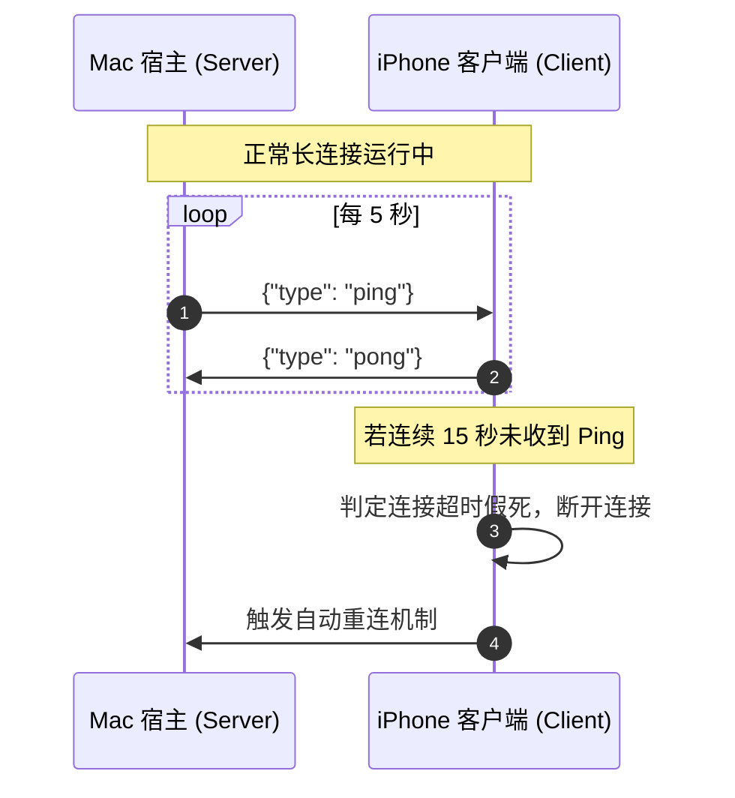

# Vocal 双端通信与 WebSocket 协议标准规范

本文档为 `system-architect`、`mac-host-dev` 与 `flutter-mobile-dev` 的协议唯一真实来源（Single Source of Truth）。任何协议改动必须先修改本文档，经评审后同步修改双端代码。

---

## 1. 基础网络拓扑

```mermaid
graph LR
    subgraph iOS [iOS 客户端 (Flutter)]
        Client[WebSocketClient]
    end

    subgraph Mac [Mac 宿主端 (Swift)]
        Listener[NWListener:8888]
        Bonjour[NetService: _vocal._tcp]
    end

    Bonjour -.->|1. mDNS 广播服务名与端口| Client
    Client ===|2. WebSocket 长连接 (ws://Mac_IP:8888)| Listener
```

- **传输层协议**: WebSocket (`ws://<Mac_IP>:<Port>`)
- **默认端口**: `8888`
- **mDNS 服务类型**: `_vocal._tcp`
- **mDNS 域名**: `local.`
- **编码格式**: UTF-8 文本帧 (Text Frame)

---

## 2. 消息 Payload 契约

### 2.1 文本注入消息 (Client -> Host)

#### 模式 A：结构化 JSON（当前主标准）
```json
{
  "type": "text",
  "text": "你好，这是一段语音转录文字。",
  "pressEnter": true
}
```
- **字段说明**:
  - `type` (string, required): 必须为 `"text"`。
  - `text` (string, required): 需在 Mac 端模拟打字注入的文本内容。支持多字节 UTF-16 Unicode 字符、标点符号、Emoji 及换行符。
  - `pressEnter` (bool, optional, 默认 false):
    - `true`: Mac 端完成全部 Unicode 字符注入后，自动发送一次回车键事件（`kVK_Return`, `0x24`）；
    - `false`: 仅注入文本，不按下回车。

#### 模式 B：纯文本降级（向后兼容）
若 Mac 端接收到的 Payload 无法被解析为 JSON（例如由于早期版本客户端发送纯字符串），Mac 端不得抛出异常断开连接，必须平滑降级：
- 直接将整个原始字符串作为文本注入到焦点窗口；
- 行为等价于 `{"type": "text", "text": payload, "pressEnter": false}`。

---

### 2.2 心跳保活协议 (双向)

为应对 Wi-Fi 休眠、路由器 NAT 超时与局域网网络抖动，双端维护心跳机制：



1. **服务端发 Ping (Host -> Client)**:
   - 触发周期: 每 5 秒
   - 载荷: `{"type": "ping"}`
2. **客户端应答 Pong (Client -> Host)**:
   - 触发时机: 收到 Ping 后立即响应
   - 载荷: `{"type": "pong"}`
3. **超时与重连策略**:
   - 客户端超时阈值: 15 秒（连续 3 次未收到 Ping）；
   - 超时后客户端将 Socket 状态标记为断开，启动去抖重连扫描。

---

## 3. 局域网异常处理指南
1. **AP 隔离 (Access Point Isolation)**:
   - 某些路由器会阻止同一 Wi-Fi 内的设备直接互相访问。
   - 当 mDNS 扫描持续超时时，客户端应在界面提供明确提示：“请检查路由器是否开启了 AP 隔离 / 访客网络隔离”。
2. **多网卡与 IP 漂移**:
   - 当 Mac 切换 Wi-Fi 或开启热点时，NetService 会动态重新注册广播；
   - 客户端在重连时必须重新解析 mDNS 对应的最新 IP，不可死锁旧 IP。

