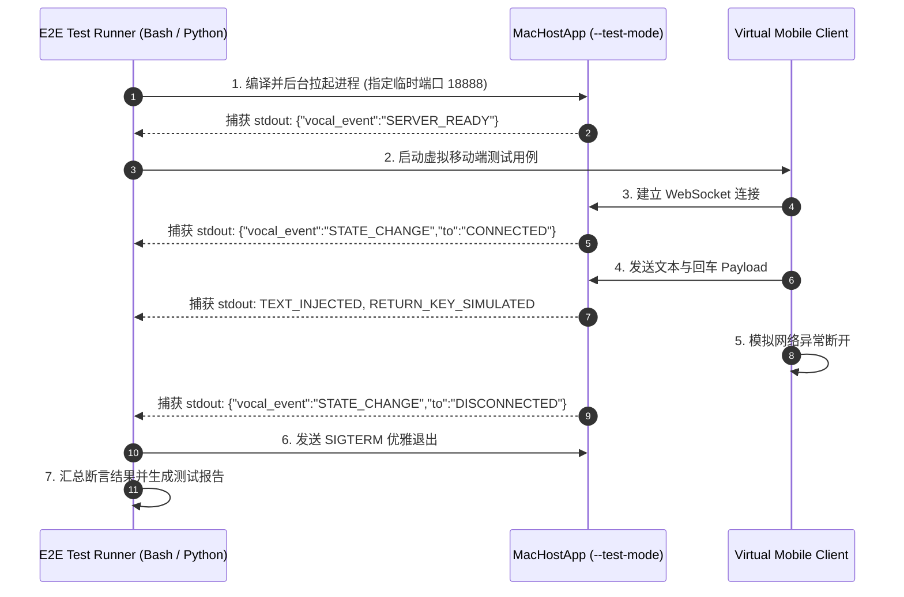

# Vocal 跨端自动化集成测试 (E2E) 架构设计规范

本文档为 Vocal 项目跨端自动化集成测试的顶层设计规范，定义测试拓扑、测试用例规格、双端可测性改造契约与自动化执行标准，作为 `mac-host-dev`、`flutter-mobile-dev` 与 `code-reviewer` 的实施依据。

---

## 1. 架构总览与测试分层拓扑

为了保障从移动端语音草稿到 Mac 焦点光标字符注入的端到端质量，测试体系采用分层测试金字塔（Test Pyramid）架构：

```mermaid
graph TD
    subgraph L3 [Layer 3: 真实跨端 E2E 自动化测试]
        E2ERunner[E2E Runner 自动化套件]
        MacProcess[真实 MacHostApp 进程 (--test-mode)]
        VirtualClient[虚拟移动客户端 (Virtual Mobile Client)]
        E2ERunner -->|拉起并监控 stdout| MacProcess
        E2ERunner -->|调度驱动| VirtualClient
        VirtualClient <===>|mDNS 发现 + WebSocket 直连| MacProcess
    end

    subgraph L2 [Layer 2: Mac 宿主协议与注入隔离测试]
        HostProtocolTest[Mac Host 协议与状态机验证]
        MockClient[Mock Client 注入器]
        HostProtocolTest --> MockClient
        MockClient -->|协议帧驱动与边界注入| MacProcess
    end

    subgraph L1 [Layer 1: Mobile 客户端状态机集成测试]
        MobileStateTest[Flutter Controller 集成测试]
        MockHost[Mock WebSocket Server]
        MobileStateTest -->|状态流转驱动| MockHost
    end
```

### 1.1 分层职责与执行场景

| 分层 | 测试目标 | 执行环境 | 运行速度 | 适用场景 |
| :--- | :--- | :--- | :--- | :--- |
| **Layer 1: Mobile 客户端状态机集成测试** | 验证 Flutter 端 `VocalHomeController` 的连接状态转移、草稿保护、重连退避、Ping/Pong 应答 | 本地开发机 / CI (无需 Mac 宿主进程) | 秒级 (< 3s) | 客户端功能改动、PR 准入测试 |
| **Layer 2: Mac 宿主协议隔离测试** | 验证 Mac 端 NWListener 握手、结构化 JSON 解析、纯文本降级、心跳下发与超时断开 | 本地开发机 / CI (仅编译 MacHost) | 秒级 (< 5s) | 宿主端协议改动、注入逻辑优化 |
| **Layer 3: 真实跨端端到端 (E2E) 测试** | 验证真实拉起 MacHost 进程后，虚拟移动客户端与其完成 mDNS 发现、长连接握手、文本/回车注入、网络抖动恢复全链路 | 本地开发机 / macOS CI Runner | 快速 (< 15s) | 跨端集成验证、发版发布门禁 (Release Gate) |

---

## 2. 测试用例矩阵与断言规格

以下为跨端自动化集成测试的核心用例矩阵：

| 用例编号 | 用例名称 | 核心测试点 | 前置条件 | 操作步骤 | 预期断言 (Pass 判定标准) |
| :--- | :--- | :--- | :--- | :--- | :--- |
| **TC-E2E-01** | mDNS / Bonjour 服务发布与发现 | 服务发现合规性 | MacHost 启动成功 | 虚拟客户端执行 mDNS 查询 `_vocal._tcp.local.` | 1. 成功发现服务记录<br>2. Service Type 为 `_vocal._tcp`<br>3. 端口号与配置端口（默认 8888）一致<br>4. 解析的主机名与 IP 有效 |
| **TC-E2E-02** | WebSocket 握手与连接状态双向同步 | 双端状态机握手 | MacHost 处于等待连接状态 | 虚拟客户端发起 `ws://<Mac_IP>:<Port>` 连接 | 1. WebSocket 101 Switching Protocols 成功<br>2. MacHost 状态变为 `CONNECTED`<br>3. 菜单栏标题显示 `✅ 已连接`<br>4. 状态栏图标显示高亮 `mic.fill`<br>5. 客户端状态变为 `Connected to Mac` |
| **TC-E2E-03** | 双向心跳保活 (Ping-Pong) 链路 | 长连接存活校验 | 双端已连接 | 1. 维持长连接 12 秒<br>2. 监控通信链路帧 | 1. MacHost 每 5s ± 200ms 发送一次 `{"type":"ping"}`<br>2. 客户端在 100ms 内回包 `{"type":"pong"}`<br>3. 状态保持 `CONNECTED` 不发生抖动 |
| **TC-E2E-04** | 结构化文本注入 (无回车) | 协议与注入正确性 | 双端已连接 | 客户端发送 `{"type":"text","text":"你好Vocal","pressEnter":false}` | 1. MacHost 接收并识别为有效 JSON 格式<br>2. 触发 Unicode 字符注入事件序列（包含 "你好Vocal"）<br>3. 断言未触发 `kVK_Return` (0x24) 按键事件 |
| **TC-E2E-05** | 结构化文本注入 (带回车控制) | 回车模拟时序校验 | 双端已连接 | 客户端发送 `{"type":"text","text":"git status","pressEnter":true}` | 1. MacHost 触发 Unicode 字符注入<br>2. 字符注入后等待 30ms，触发 `kVK_Return` 按键按下与抬起事件<br>3. 客户端本地草稿清空，历史记录首项为 `"git status"` |
| **TC-E2E-06** | 纯文本向后兼容平滑降级 | 兼容性防崩溃 | 双端已连接 | 客户端发送非 JSON 纯文本 `"LegacyPlainText_123"` | 1. MacHost JSON 反序列化失败时不抛出异常、不切断连接<br>2. 自动降级为平滑注入模式<br>3. 注入该纯文本，`pressEnter` 默认为 `false` |
| **TC-E2E-07** | 网络假死与心跳超时自愈 (15s Timeout) | 异常超时容错 | 双端已连接 | 客户端主动丢弃 MacHost 发送的所有 Ping 帧，不予应答 | 1. 达到超时阈值（15s，连续丢失 3 次 Ping）<br>2. 客户端主动标记断开，进入重新扫描状态<br>3. MacHost 检测到底层套接字断开或重置为等待状态 |
| **TC-E2E-08** | 偶发网络断连与自动重连自愈 | 网络闪断恢复 | 双端已连接 | 客户端强制 RST 关闭底层 TCP 套接字，2 秒后重新发起连接 | 1. MacHost 立即检测到 Connection Cancelled/Failed，状态切换为 `⏳ 等待连接...`<br>2. 客户端断开期间，本地草稿内容完整保留绝不丢失<br>3. 客户端发起自动重连，双端成功自愈并恢复 `CONNECTED` |
| **TC-E2E-09** | 单设备排他与重入保护 | 连接冲突容错 | 客户端 A 已连接 | 客户端 B 尝试建立新 WebSocket 连接 | 1. 验证 MacHost 连接策略（平滑接管或拒绝排队）<br>2. 服务端与活跃客户端保持状态一致，不引发主线程崩溃 |

---

## 3. 可测性支持需求 (Testability Requirements)

为保证自动化测试无需人工干预、无需 GUI 手动操作、且能在无 Accessibility 授权的 CI 环境中运行，双端需暴露标准化可测性接口。

### 3.1 macOS 宿主端 (`mac-host-dev`) 可测性支持

#### 3.1.1 命令行启动标志位 (CLI Flags)
Mac 宿主端二进制文件需支持以下运行参数：
- `--test-mode`:
  - 启动测试模式：保持原有业务逻辑，但在 `stdout` 实时输出**机器可读的标准 JSON 行日志 (NDJSON)**；
  - 即使调用了 `freopen` 写日志文件，在 `--test-mode` 下仍必须镜像输出到原始 stdout。
- `--port <PORT>`:
  - 允许动态指定 WebSocket 监听端口（如 `--port 18888` 或 `--port 0`），避免与开发常驻进程 8888 端口冲突。
- `--no-cg-inject` (或 `--mock-inject`):
  - 模拟按键注入：在此模式下，接收到文本和回车时，不调用系统级 `CGEvent.post`，而是记录内部注入事件日志。
  - **价值**：允许在 GitHub Actions 或未开启辅助功能权限的 CI 沙盒中 100% 运行全套 E2E 测试，彻底解决 macOS CI 环境没有 Accessibility 授权而卡死的痛点。
- `--ping-interval <SECONDS>`:
  - 可配置心跳间隔（如 `--ping-interval 1.0`），可将测试中 15s 的超时等待大幅缩短至 3s 内，提升测试回归速度。

#### 3.1.2 宿主事件可观测性契约 (Structured Event Contract)
在 `--test-mode` 下，MacHost 每次发生核心状态转移或事件，必须向 `stdout` 输出单行 JSON，以 `{"vocal_event": ...}` 开头：

```json
{"vocal_event": "SERVER_READY", "port": 8888, "timestamp": 1700000000.123}
{"vocal_event": "MDNS_PUBLISHED", "serviceName": "VocalHost", "type": "_vocal._tcp", "port": 8888}
{"vocal_event": "STATE_CHANGE", "from": "DISCONNECTED", "to": "CONNECTED", "client": "127.0.0.1"}
{"vocal_event": "PING_SENT", "timestamp": 1700000005.123}
{"vocal_event": "PONG_RECEIVED", "timestamp": 1700000005.150}
{"vocal_event": "PAYLOAD_RECEIVED", "mode": "JSON", "raw": "{\"type\":\"text\",\"text\":\"hello\",\"pressEnter\":true}"}
{"vocal_event": "TEXT_INJECTED", "text": "hello", "charCount": 5, "mocked": true}
{"vocal_event": "RETURN_KEY_SIMULATED", "mocked": true}
{"vocal_event": "STATE_CHANGE", "from": "CONNECTED", "to": "DISCONNECTED", "reason": "CONNECTION_CLOSED"}
```

### 3.2 Flutter 移动端 (`flutter-mobile-dev`) 可测性支持

#### 3.2.1 控制器依赖解耦 (Dependency Injection)
- 允许在测试中向 `VocalHomeController` 注入自定义参数：
  - `wsUrl`: 支持直接传入测试目标地址（跳过 mDNS 直接连接 `ws://127.0.0.1:<Port>`）；
  - `heartbeatTimeout`: 允许配置心跳超时阈值（如改为 2 秒）；
  - `autoInit`: 默认为 true，测试时设为 false 避免自动启动音频引擎和 mDNS。
- 状态机状态暴露：
  - 引入枚举 `VocalConnectionState`：`{ disconnected, searching, connecting, connected, reconnecting }`，供测试代码直接 `expect(controller.connectionState, VocalConnectionState.connected)`。

---

## 4. 测试套件技术选型与执行标准

### 4.1 技术选型与选型理由

| 层次 | 选用技术栈 | 选型理由 |
| :--- | :--- | :--- |
| **移动端集成测试** | **Flutter Test (Dart 原生)** | 零新增依赖，秒级运行，完全在内存中拉起 `HttpServer.bind` WebSocket Mock 宿主，测试移动端状态机、输入草稿和异常恢复。 |
| **跨端 E2E 套件** | **Python 3 (`websockets` + `pytest` 或原生 asyncio 脚本)** | 1. macOS 系统默认自带 Python 3；<br>2. 异步处理 WebSocket、并发管道捕获 MacHost 进程 stdout 极为简单轻量；<br>3. 脚本自包含，单文件即可运行，开发与 CI 环境均无需复杂配置。 |
| **一键回归入口** | **Bash 脚本 (`scripts/run_e2e_tests.sh`)** | 统一编排：从 `swiftc` 秒级编译 -> 启动 MacHost 测试进程 -> 运行测试矩阵 -> 优雅终止并清理端口 -> 输出总结。 |

### 4.2 跨端 E2E 执行流生命周期 (Runner Lifecycle)



### 4.3 自动化集成测试目录结构标准

```text
vocal/
├── mac/
│   ├── VocalHostApp.swift         # 宿主主源码 (增加 --test-mode 支持)
│   └── build_macos.sh
├── mobile/
│   ├── lib/
│   └── test/
│       ├── vocal_home_controller_test.dart  # 单元测试
│       └── mock_host_integration_test.dart  # Layer 1: Flutter Mock Host 集成测试
├── tests/
│   ├── e2e/
│   │   ├── __init__.py
│   │   ├── virtual_client.py      # 虚拟移动端 (实现 WebSocket、心跳应答、注入发送)
│   │   ├── test_handshake_state.py# TC-01, TC-02 握手与状态同步
│   │   ├── test_payload_inject.py # TC-04, TC-05, TC-06 消息格式与回车注入
│   │   └── test_heartbeat_reconnect.py # TC-03, TC-07, TC-08 容错与重连
│   └── run_e2e.py                 # 一键执行所有 E2E 用例的轻量驱动脚本
└── scripts/
    └── run_all_tests.sh           # 全链路自动化测试主入口 (Flutter + E2E)
```

---

## 5. 架构师实施演进与委派指引

为推进 TODO.md 跨端自动化集成测试任务的高质落地，委派分工如下：

1. **`mac-host-dev` (宿主改造与自测)**:
   - 在 `mac/VocalHostApp.swift` 中解析命令行参数 `--test-mode`、`--port`、`--no-cg-inject` 与 `--ping-interval`；
   - 增加事件标准输出日志方法（NDJSON），确保测试模式下事件实时打印到 stdout 供测试 Harness 捕获；
   - 在 `--no-cg-inject` 模式下仅触发事件日志，不调用系统 Accessibility API，使得无权限环境下也可顺畅执行测试。

2. **`flutter-mobile-dev` (移动端集成与可测性)**:
   - 在 `mobile/lib/page/vocal_home_controller.dart` 中支持直接指定 `wsUrl` 连接方式，便于测试直接对准指定端口；
   - 编写 `mobile/test/mock_host_integration_test.dart`，使用 Dart 内置 WebSocket Server 验证移动端在网络断连、心跳超时场景下的状态机流转与草稿无损保障。

3. **测试套件实现 (`tests/e2e/`)**:
   - 编写轻量化 `virtual_client.py` 与端到端测试用例；
   - 编写 `scripts/run_all_tests.sh` 脚本，串联编译、单元测试、宿主启动与 E2E 校验，实现零配置一键执行。

4. **`code-reviewer` (质量审计)**:
   - 严格审查 Mac 端测试模式改造是否影响常规模式的内存与二进制体积；
   - 确保 `--no-cg-inject` 仅在测试模式下生效，常规运行必须严格保留 `AXIsProcessTrusted()` 权限防御；
   - 验证测试套件在没有外部复杂环境依赖下可在 CI 秒级跑通。
