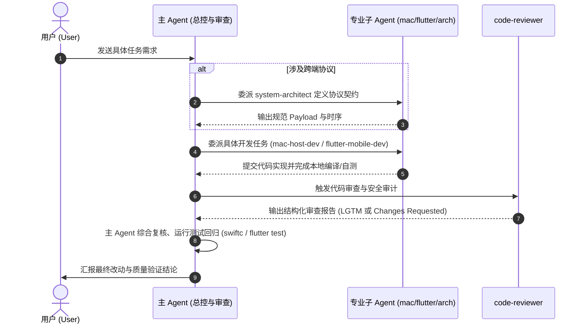

# AGENTS.md - Vocal 项目开发与协作指南

本指南是 Vocal 项目的最高指导准则，采用 **总分结合 (Hub & Spoke)** 架构：**主 Agent** 负责需求总控、子 Agent 调度与质量审查；具体领域的开发与维护细则下沉至专有子 Agent 文件与参考规范中。

---

## 1. 项目简介与架构总览

**Vocal** 是一个基于 iPhone 的 Mac 高速语音录入键盘，将 iPhone 转换为低延迟远程输入设备：
1. **iOS 客户端**: Apple 原生 `SFSpeechRecognizer` 本地语音转录，累加为本地草稿；
2. **局域网通信**: mDNS (`_vocal._tcp`) 自动发现，WebSocket (`ws://<Mac_IP>:8888`) 低延迟直连；
3. **macOS 宿主**: 接收文本并通过 Accessibility API (`CGEvent`) 将字符与回车无缝注入到当前活跃应用光标焦点。

---

## 2. 多 Agent 团队矩阵与职责分工

所有具体业务改动由主 Agent 委派给对应的垂直领域专家处理，子 Agent 细则与开发规范查阅独立设定文件：

| Agent 标识 | 角色定位 | 核心职责与管辖范围 | 独立设定与规范 |
| :--- | :--- | :--- | :--- |
| **`system-architect`** | 架构与协议专家 | 全链路低延迟架构、mDNS 拓扑、WebSocket 协议制定与双端状态机对齐 | [`agents/system-architect.md`](.agents/agents/system-architect.md) |
| **`mac-host-dev`** | macOS 宿主专家 | `mac/` 目录开发，`VocalHostApp.swift`、Accessibility 字符/回车注入、DMG 打包 | [`agents/mac-host-dev.md`](.agents/agents/mac-host-dev.md) |
| **`flutter-mobile-dev`** | Flutter 移动端专家 | `mobile/` 目录开发，SFSpeechRecognizer 听写、nsd 局域网发现、草稿累加与动效 | [`agents/flutter-mobile-dev.md`](.agents/agents/flutter-mobile-dev.md) |
| **`code-reviewer`** | 代码审查守门员 | 全局代码 Diff 审查、协议向后兼容性审计、真机防崩溃规约、测试验证 | [`agents/code-reviewer.md`](.agents/agents/code-reviewer.md) |
| **主 Agent** *(Coordinator)* | 总控调度与审查官 | 需求解析、子 Agent 调度委派、改动综合审查、自动化测试回归、最终向用户汇报 | 本文档与 [vocal-agents Skill](.agents/skills/vocal-agents/SKILL.md) |

---

## 3. 协作工作流 (Workflow)

---

## 4. 全局核心铁律 (CRITICAL RULES)

所有 Agent 必须无条件遵守以下核心底线（违者直接驳回）：

1. **语言规则**:
   - 始终使用**中文**回答用户问题，Git Commit Message 必须使用**中文**。
2. **iOS 26 真机严禁 Debug 模式**:
   - 真机运行必须加 `--profile` 或 `--release`（`fvm flutter run -d <ID> --profile`），严禁使用 Debug 触发内存崩溃。
3. **协议向后兼容**:
   - Mac 端必须永远向下兼容纯文本直接注入（非 JSON 字符串不得抛错或断开）。
4. **草稿不自动发送**:
   - 语音静音或停止仅关闭麦克风，绝对不得自动发送或清空本地草稿框（`textDraft`）。
5. **Mac 端零外部依赖与权限防御**:
   - 保持纯 Swift 零外部依赖（`swiftc` 秒级编译）；注入前必须校验 `AXIsProcessTrusted()` 并具备权限未授防御引导。
6. **终端与文件操作**:
   - 优先使用 IDE 内置工具，避免终端重定向；禁止执行交互式输入命令；文件保持 UTF-8 无 BOM 编码。

---

## 5. 项目参考规范索引

- **双端通信与 WebSocket 协议唯一真实源**: [communication-protocol.md](.agents/skills/vocal-agents/references/communication-protocol.md)
- **跨端自动化集成测试架构规范**: [e2e-testing-architecture.md](.agents/skills/vocal-agents/references/e2e-testing-architecture.md)
- **致命避坑与开发铁律清单**: [critical-rules.md](.agents/skills/vocal-agents/references/critical-rules.md)
- **多 Agent 调度编排技能**: [SKILL.md](.agents/skills/vocal-agents/SKILL.md)
- **常用调试备忘**: [DEBUG.md](DEBUG.md)
