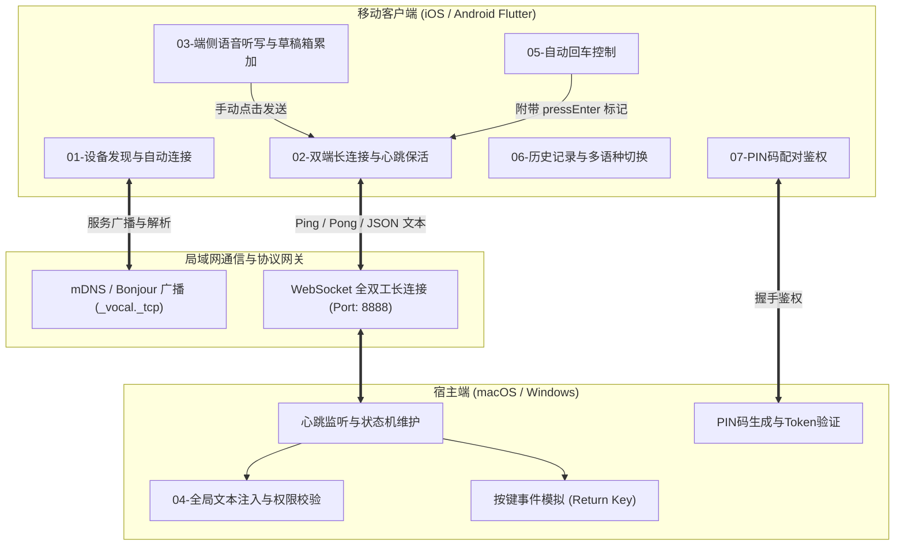

# Vocal 功能列表与产品需求文档 (PRD) 索引

本文档汇总了 **Vocal (基于 iPhone 的 Mac 高速语音录入键盘)** 的完整功能全景、端到端架构模块及详细产品需求文档（PRD）索引。

---

## 1. 系统功能全景架构

---

## 2. 功能矩阵与 PRD 导航

| 编号 | 功能模块 | 运行平台 | 状态 | PRD 文档链接 |
| :--- | :--- | :--- | :--- | :--- |
| **01** | **局域网设备发现与自动连接** | 双端 (iOS/Mac) | ✅ 已上线 | [01-局域网设备发现与自动连接.md](file:///Users/idcpj/workspace/vocal/docs/功能/01-局域网设备发现与自动连接.md) |
| **02** | **双端长连接与心跳保活** | 双端 (iOS/Mac) | ✅ 已上线 | [02-双端长连接与心跳保活.md](file:///Users/idcpj/workspace/vocal/docs/功能/02-双端长连接与心跳保活.md) |
| **03** | **端侧语音识别与草稿箱累加** | 移动端 (iOS) | ✅ 已上线 | [03-端侧语音识别与草稿箱累加.md](file:///Users/idcpj/workspace/vocal/docs/功能/03-端侧语音识别与草稿箱累加.md) |
| **04** | **全局文本注入与辅助功能权限** | 宿主端 (Mac) | ✅ 已上线 | [04-全局文本注入与辅助功能权限.md](file:///Users/idcpj/workspace/vocal/docs/功能/04-全局文本注入与辅助功能权限.md) |
| **05** | **自动回车控制与按键模拟** | 双端 (iOS/Mac) | ✅ 已上线 | [05-自动回车控制与按键模拟.md](file:///Users/idcpj/workspace/vocal/docs/功能/05-自动回车控制与按键模拟.md) |
| **06** | **发送历史管理与识别语种切换** | 移动端 (iOS) | ✅ 已上线 | [06-发送历史管理与识别语种切换.md](file:///Users/idcpj/workspace/vocal/docs/功能/06-发送历史管理与识别语种切换.md) |
| **07** | **设备安全配对与PIN码鉴权** | 双端 (iOS/Mac) | 📋 规划中 | [07-设备安全配对与PIN码鉴权.md](file:///Users/idcpj/workspace/vocal/docs/功能/07-设备安全配对与PIN码鉴权.md) |

---

## 3. 核心设计规范与原则

1. **极致低延迟 (Ultra-low Latency)**：局域网点对点直连，拒绝公网服务器转发，打字响应在毫秒级完成。
2. **端侧隐私保护 (Privacy First)**：采用系统原生离线/端侧听写技术，音频数据不离开设备。
3. **草稿不丢、不误发 (Reliable Draft)**：语音转录作为本地草稿缓冲，由用户最终确认并手动点击发送，杜绝实时发送带来的错字上屏尴尬。
4. **向下兼容与优雅降级 (Backward Compatibility)**：服务端永远兼容纯文本格式，双端协议采用增量扩展设计。
