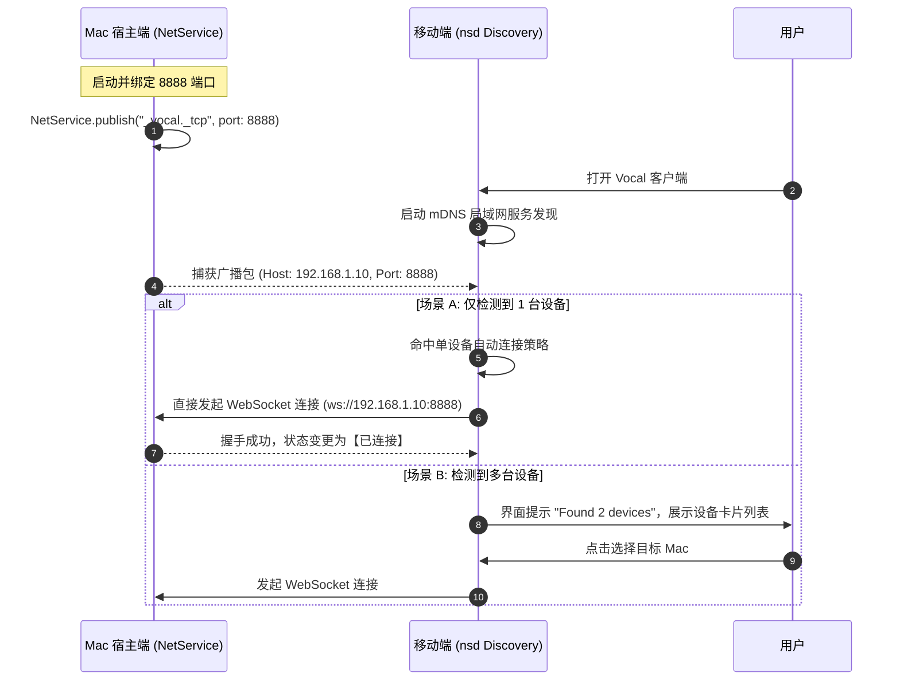

# PRD-01: 局域网设备发现与自动连接

| 文档版本 | 状态 | 对应模块 | 负责人 |
| :--- | :--- | :--- | :--- |
| v1.0.0 | ✅ 已上线 | `mac/` (NetService), `mobile/` (nsd) | Vocal 团队 |

---

## 1. 功能概述与价值

- **功能概述**：利用 mDNS (Bonjour / ZeroConf) 协议，在同一局域网（Wi-Fi）内实现 Mac 宿主端无配置自动广播与移动客户端秒级自动发现。
- **解决痛点**：传统网络工具需手动查 IP、输端口，门槛高且 IP 经常漂移。本功能让用户零感知完成跨端寻址。
- **自动化体验**：
  - 当局域网内**仅发现 1 台**可用的 Mac 宿主时，移动端**自动触发连接**，无需人工二次点击；
  - 当发现多台设备时，展示优雅的发现列表供用户选择。

---

## 2. 功能详情列表

| 编号 | 详细功能项 | 运行端 | 规则与行为描述 |
| :--- | :--- | :--- | :--- |
| **1.1** | **mDNS 服务注册与广播** | Mac 宿主端 | 启动时通过 `NetService` 广播服务类型 `_vocal._tcp`，监听并宣告服务端口（默认 `8888`），服务名为当前 Mac 电脑名称（如 `Alice's MacBook Pro`）。 |
| **1.2** | **局域网多播扫描** | 移动端 | 移动端启动或网络恢复时，调用 `nsd.startDiscovery` 监听 `_vocal._tcp` 服务。 |
| **1.3** | **单设备自动连接 (Auto-Connect)** | 移动端 | 若扫描列表从空变为命中唯一的 1 台设备，且当前处于未连接状态，立即自动调用 `connectToService` 建立 WebSocket 连接。 |
| **1.4** | **多设备列表与手动切换** | 移动端 | 发现多台设备时，在状态栏或设备页列出所有 Mac 名称、IP 及端口，用户可点击任意一台主动连接。 |
| **1.5** | **多播资源释放与防泄漏** | 移动端 | 建立连接或 App 进入后台时，及时关闭 mDNS 监听以释放系统多播锁与射频功耗。 |
| **1.6** | **网络异常与去抖重扫** | 移动端 | 连接断开时，若开启自动重连，延迟 1 秒触发新一轮 mDNS 扫描，防止高频抖动。 |

---

## 3. 业务与交互流程 (Mermaid)

---

## 4. 通信与协议标准

### 4.1 Bonjour / mDNS 广播规范
- **服务类型 (Service Type)**: `_vocal._tcp`
- **广播域名 (Domain)**: `local.`
- **默认服务端口 (Port)**: `8888`
- **默认服务名 (Name)**: `Mac 本机名称` (如未获取到则默认 `VocalHost`)

### 4.2 TXT Record 扩展规范（向后兼容预留）
| 字段 Key | 类型 | 示例值 | 说明 |
| :--- | :--- | :--- | :--- |
| `version` | String | `"1.0.0"` | 宿主版本号 |
| `pin` | String | `"0"` / `"1"` | 是否强制要求 PIN 码鉴权 |
| `os` | String | `"macos"` | 宿主操作系统标识 |

---

## 5. 异常边界与容灾方案

1. **路由器开启 AP 隔离 (Client Isolation)**:
   - 现象: 手机与电脑在同一 Wi-Fi，但始终搜不到设备。
   - 容灾: 客户端在长时间搜索无果时，提供排查引导：“请确认电脑与手机连接相同 Wi-Fi，且路由器未开启 AP 隔离/访客隔离”；提供手动输入 IP/端口直连入口。
2. **Mac 端 IP 发生漂移**:
   - 宿主在 Wi-Fi 重连后 IP 可能改变。客户端在连接断开后，清空旧 IP 缓存，重新通过 mDNS 获取最新解析地址，杜绝连接死锁。
