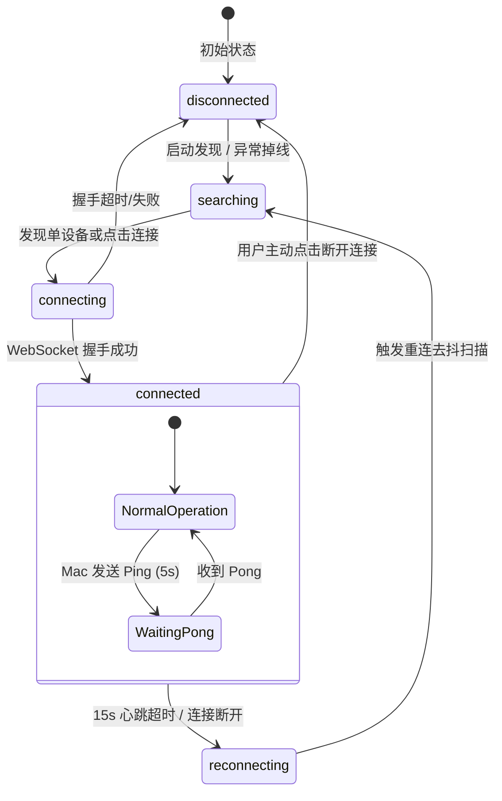
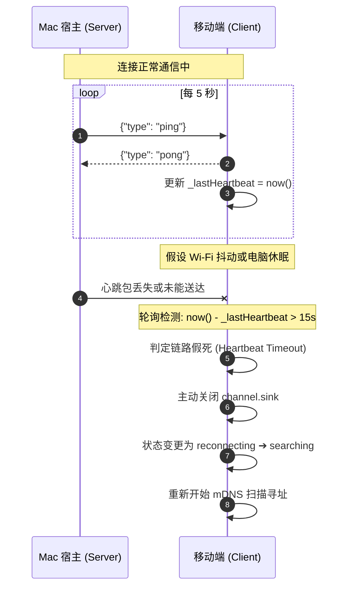

# PRD-02: 双端长连接与心跳保活

| 文档版本 | 状态 | 对应模块 | 负责人 |
| :--- | :--- | :--- | :--- |
| v1.0.0 | ✅ 已上线 | `mac/` (NWConnection), `mobile/` (WebSocketChannel) | Vocal 团队 |

---

## 1. 功能概述与价值

- **功能概述**：基于 WebSocket (TCP) 建立稳定的双端长连接，通过定时心跳 Ping/Pong 报文与双向超时检测机制，保证局域网通信实时、敏捷、自愈。
- **解决痛点**：
  - 移动设备锁屏、切后台或 Wi-Fi 信号抖动时容易产生“半开连接”（TCP 假死）；
  - 若无有效心跳，手机误以为已连接，打字发送后电脑无任何反应，破坏用户信赖。

---

## 2. 功能详情列表

| 编号 | 详细功能项 | 运行端 | 规则与行为描述 |
| :--- | :--- | :--- | :--- |
| **2.1** | **WebSocket 全双工建立** | 双端 | 客户端与宿主 8888 端口完成标准 HTTP 升级握手，握手成功后双端状态同步置为 `CONNECTED`。 |
| **2.2** | **服务端心跳发起 (Ping)** | Mac 宿主端 | Mac 作为 Server 端，每隔 5 秒向活跃客户端发送心跳探测包 `{"type": "ping"}`。 |
| **2.3** | **客户端心跳响应 (Pong)** | 移动端 | 客户端收到 Ping 报文后，立即应答 `{"type": "pong"}`，并刷新本地最后活跃时间戳 `_lastHeartbeat`。 |
| **2.4** | **假死超时判定与切断** | 移动端 | 客户端维护检测协程，若连续 15 秒（即 3 次心跳周期）未收到服务端信号，判定连接假死，主动切断旧 Socket。 |
| **2.5** | **自动断线重连** | 移动端 | 在非用户主动主动点击 Disconnect 的前提下，连接因异常切断后，自动回到 `searching` 状态并发起重新寻址与连接。 |
| **2.6** | **Mac 状态栏与图标响应** | Mac 宿主端 | 连接建立时状态栏麦克风图标变亮绿 (`mic.fill`)，断开时恢复深色轮廓 (`mic`) 并停止心跳定时器。 |

---

## 3. 业务与交互流程 (Mermaid)

### 3.1 客户端状态机流转图 (State Diagram)



### 3.2 心跳保活与超时自愈时序图 (Sequence Diagram)



---

## 4. 协议数据载荷 (Payload)

### 4.1 服务端 Ping 报文 (Host -> Client)
```json
{
  "type": "ping"
}
```

### 4.2 客户端 Pong 报文 (Client -> Host)
```json
{
  "type": "pong"
}
```

---

## 5. 异常处理与性能约束

1. **多连接互斥保护**：
   - Mac 端若收到新客户端连接请求，优先关闭旧的陈旧连接（Stale Connection），确保单焦点映射唯一性，杜绝多手机并发争抢。
2. **移动端后台挂起处理**：
   - 移动端进入后台若操作系统暂停 Socket，重新唤醒时立即触发心跳校验，快速判定连接健康度并无缝重连。
