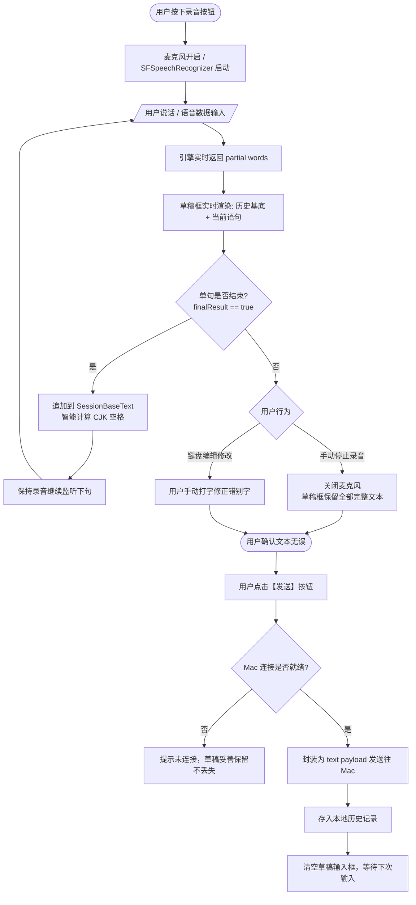

# PRD-03: 端侧语音识别与草稿箱累加

| 文档版本 | 状态 | 对应模块 | 负责人 |
| :--- | :--- | :--- | :--- |
| v1.0.0 | ✅ 已上线 | `mobile/` (speech_to_text, VocalHomeController) | Vocal 团队 |

---

## 1. 功能概述与价值

- **功能概述**：调用 Apple 原生 `SFSpeechRecognizer` 引擎在端侧实时进行语音转文字，并自动无缝累加到本地草稿框；由用户核对无误后**手动点击发送**至电脑。
- **解决痛点**：
  - 传统语音实时打字存在“错字即上屏”、“边说边变”的弊端，在 IM 软件或工作流中极容易误发错别字；
  - 苹果听写每句话停顿后容易自动结束录音，导致用户必须频繁重新点击麦克风。
- **核心升级**：
  - **连续听写不中断**：单句识别完毕自动沉淀为基底文本（`_sessionBaseText`），麦克风持续保持监听；
  - **中英文智能拼接**：中文之间不插入空格，英文单词之间自动补齐空格；
  - **手动确认发送原则**：录音停止仅代表麦克风关闭，绝对不自动发送草稿，将控制权完全还给用户。

---

## 2. 功能详情列表

| 编号 | 详细功能项 | 规则与行为描述 |
| :--- | :--- | :--- |
| **3.1** | **端侧离线优先识别** | 调用系统原生语音框架，优先匹配设备已下载的高精度离线语音包，无需向公网服务器上传音频数据，极速且隐私安全。 |
| **3.2** | **长语音分段平滑累加** | 维护 `_sessionBaseText` 与 `_currentSessionWords`。当引擎判定单句完成时 (`result.finalResult`)，将其追加合并入基底文本，后续语音在此基础上继续累加，不会覆盖或截断。 |
| **3.3** | **中英文标点智能间距** | 智能间距算法：<br>• 末字为中文且新字为中文：直接连接无空格（如 `你好` + `世界` ➔ `你好世界`）；<br>• 包含英文或数字：自动补齐单个空格（如 `Hello` + `World` ➔ `Hello World`）。 |
| **3.4** | **双模编辑（语音 + 软键盘）** | 草稿框支持触控编辑，用户可通过屏幕软键盘随时插入、修改、删除错别字，修改后的文字实时更新基底文本。 |
| **3.5** | **手动发送门禁 (Manual Send)** | 仅当用户主动轻触绿色“发送 (Send)”按钮时，才将草稿内容通过 WebSocket 打包发往 Mac。录音结束或静音超时绝不自动发送。 |
| **3.6** | **发送后自动归档清空** | 发送成功后自动清空当前草稿输入框，并将该条文本追加记录到“历史记录”列表顶部；若发送失败（如未连接），保留草稿绝不丢失。 |

---

## 3. 业务与交互流程 (Mermaid)



---

## 4. 文本拼接算法核心规范

```text
给定 BaseText 与 SpokenText：
1. 若 BaseText 为空，返回 SpokenText；
2. 若 SpokenText 为空，返回 BaseText；
3. 取 BaseText 末尾非空字符 c1，SpokenText 开头非空字符 c2；
4. 若 c1 与 c2 均为 CJK 统一表意文字 (Unicode: [\u4e00-\u9fa5])：
   合并结果 = BaseText + SpokenText
5. 否则（如英文单词、数字、西文标点）：
   合并结果 = BaseText + " " + SpokenText
```

---

## 5. 异常场景与防护

1. **系统语音服务暂时不可用**:
   - 捕获 `SpeechToText.initialize` 异常，并在顶部醒目提示：“未检测到系统语音识别服务，可直接打字输入”；
   - 保证文本输入框可独立打字使用，Vocal 仍可作为“手机无声键盘”向 Mac 传输文字。
2. **麦克风权限被拒**:
   - 首次启动检测权限，被拒时引导用户前往 iOS `系统设置 > Vocal > 麦克风/语音识别` 开启权限。
