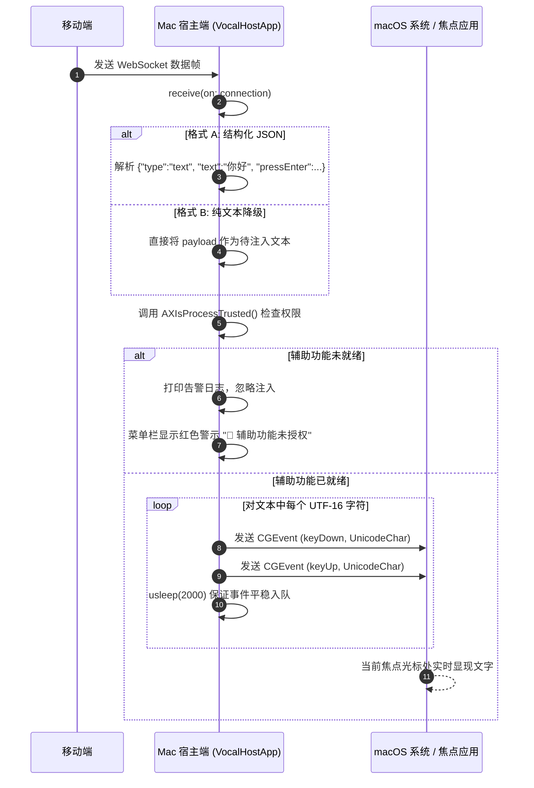

# PRD-04: 全局文本注入与辅助功能权限

| 文档版本 | 状态 | 对应模块 | 负责人 |
| :--- | :--- | :--- | :--- |
| v1.0.0 | ✅ 已上线 | `mac/` (CGEvent, AXIsProcessTrusted) | Vocal 团队 |

---

## 1. 功能概述与价值

- **功能概述**：Mac 宿主程序作为菜单栏常驻后台进程，接收来自手机的文本，利用 macOS 底层 Accessibility (`CGEvent`) 接口将 Unicode 字符串逐字注入到当前系统活跃应用的光标焦点处。
- **解决痛点**：
  - 无需第三方应用做任何插件适配，即可在任意支持打字的地方（如 VS Code、微信、Obsidian、终端、浏览器输入框）实现无缝键盘级输入；
  - 严谨处理辅助功能授权，防止无权限导致“静默丢字”。

---

## 2. 功能详情列表

| 编号 | 详细功能项 | 规则与行为描述 |
| :--- | :--- | :--- |
| **4.1** | **常驻菜单栏与无 Dock 图标** | 宿主作为轻量工具运行（`LSUIElement = true`），不在 Dock 栏占用图标，仅在顶部状态栏常驻，资源占用低。 |
| **4.2** | **双协议解析与平滑降级** | 优先尝试解析结构化 JSON（`{"type":"text", ...}`）；若解析失败，直接将原始文本字符串平滑降级注入，向下兼容纯文本客户端。 |
| **4.3** | **辅助功能权限校验 (Gatekeeper)** | 注入前调用 `AXIsProcessTrusted()`：<br>• 若已授权：执行打字；<br>• 若未授权：菜单栏显示红色警示“🔴 辅助功能未授权”，点击直接唤起系统授权设置窗口。 |
| **4.4** | **Unicode 字符级事件合成** | 将输入文本拆解为 UTF-16 字符数组，通过 `CGEvent.keyboardSetUnicodeString` 创建成对的 `keyDown` 与 `keyUp` 虚拟事件。 |
| **4.5** | **输入微延迟保护 (2ms Delay)** | 字符与字符之间施加 2000 微秒 (2ms) 极微延迟，保证在 Electron 应用（如 VS Code/Slack）或重型 IDE 中接收事件队列不丢字、不错乱。 |
| **4.6** | **测试模拟注入开关 (Mock Inject)** | 支持通过启动参数 `--mock-inject` 运行，跳过真实系统键盘事件合成，专供跨端集成测试与无权限 CI 环境。 |

---

## 3. 业务与交互流程 (Mermaid)



---

## 4. 协议标准与通信载荷

### 4.1 结构化 JSON 载荷
```json
{
  "type": "text",
  "text": "这是一段在焦点光标输入的文字，支持 Emoji 😊 与标点。",
  "pressEnter": false
}
```

### 4.2 字段技术规范
- `type` (string, required): 固定为 `"text"`。
- `text` (string, required): 目标文本。支持多语言混合、换行符（`\n`）及多字节 Emoji。
- `pressEnter` (boolean, optional): 是否在文字全部注入后附带触发回车键。

---

## 5. 权限异常引导设计

```
[Mac 菜单栏点击]
  ├── ⏳ 等待连接... / ✅ 已连接
  ├── 🔴 辅助功能未授权 (点击去授权) ──> 点击直接执行：
  │                                     let url = URL(string: "x-apple.systempreferences:com.apple.preference.security?Privacy_Accessibility")!
  │                                     NSWorkspace.shared.open(url)
  ├── --------------------------
  └── 退出 Vocal (Quit)
```
