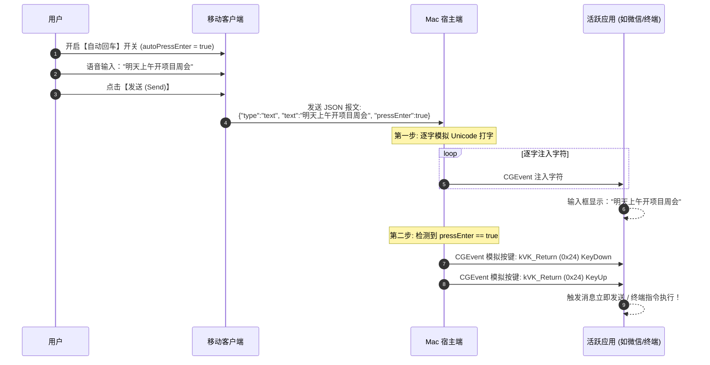

# PRD-05: 自动回车控制与按键模拟

| 文档版本 | 状态 | 对应模块 | 负责人 |
| :--- | :--- | :--- | :--- |
| v1.0.0 | ✅ 已上线 | `mobile/` (toggleAutoPressEnter), `mac/` (pressReturnKey) | Vocal 团队 |

---

## 1. 功能概述与价值

- **功能概述**：在移动端界面提供“自动回车 (Auto Enter)”独立开关。开启后，发送文本到 Mac 后会自动在当前光标处模拟按下一次回车键（Return / Enter）。
- **解决痛点**：
  - 在即时通讯工具（微信、Slack、飞书、Teams）中，文字输入完毕往往需要再按一下回车才能发送；
  - 在命令行终端（Terminal / iTerm）或搜索引擎中，输入指令或关键词后通常需要立刻按回车执行。
  - 用户手持手机说话并点击发送后，无需再去敲击 Mac 物理键盘上的回车键，实现全流程“无手接触 Mac”即可完成信息发送或指令执行。

---

## 2. 功能详情列表

| 编号 | 详细功能项 | 运行端 | 规则与行为描述 |
| :--- | :--- | :--- | :--- |
| **5.1** | **移动端独立开关 (Toggle)** | 移动端 | 界面右上角或工具栏提供“自动回车”快捷切换按钮与状态指示图标（高亮代表开启，灰色代表关闭）。 |
| **5.2** | **开关偏好持久化** | 移动端 | 用户的自动回车状态偏好实时保存在本地，应用下次冷启动时保留上一次的选择。 |
| **5.3** | **协议层附带指令** | 移动端 | 点击发送时，将当前 `autoPressEnter` 的布尔值装载到 JSON 载荷中的 `pressEnter` 字段。 |
| **5.4** | **Mac 端按键严格时序保证** | Mac 宿主端 | Mac 接收到指令后，必须**在全部 Unicode 字符逐字注入完毕后**，才执行 `pressReturnKey()`，杜绝文字还没打完就提前触发回车的竞态 Bug。 |
| **5.5** | **原生虚拟键码模拟 (kVK_Return)** | Mac 宿主端 | 调用 `CGEvent(keyboardEventSource: source, virtualKey: 0x24, keyDown: true/false)` 模拟虚拟键盘硬件回车事件。 |

---

## 3. 业务与交互流程 (Mermaid)



---

## 4. 通信协议规范

### 4.1 发送格式契约 (Client -> Host)
```json
{
  "type": "text",
  "text": "npm run build",
  "pressEnter": true
}
```

### 4.2 字段说明
- `pressEnter` (boolean, optional, 默认值为 `false`):
  - `true`: 文本注入完毕后，模拟触发回车键（虚拟键码 `0x24`）；
  - `false` 或缺省: 仅注入文本，保留光标在文本末尾，不触发回车。

---

## 5. 边界与体验设计

1. **多行文本与换行保护**：
   - 若用户文本本身包含换行符（`\n`），字符注入逻辑会将其作为普通换行注入，最后依然根据 `pressEnter` 决定是否发送最终提交回车。
2. **长文本注入缓冲**：
   - 字符注入完毕后无需等待额外长延时，回车紧随其后发出，响应总延时在毫秒级以内。
