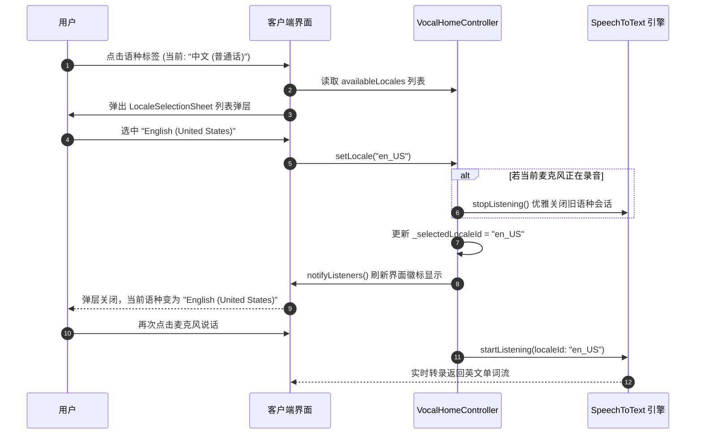

# PRD-06: 发送历史管理与识别语种切换

| 文档版本 | 状态 | 对应模块 | 负责人 |
| :--- | :--- | :--- | :--- |
| v1.0.0 | ✅ 已上线 | `mobile/` (LocaleSelectionSheet, AppStrings) | Vocal 团队 |

---

## 1. 功能概述与价值

- **功能概述**：
  1. **发送历史管理**：客户端自动沉淀用户历次发送成功的文本历史，支持一键点击回填、复用与一键清空；
  2. **识别语种动态切换**：支持实时切换 Apple Speech 原生支持的多国语种（如普通话、英语、粤语、日语等），无需重启应用；
  3. **双端国际化 (i18n)**：移动端与 Mac 宿主端 UI 全面支持中英双语自适应。
- **解决痛点**：
  - 高频重复文本（如常用提示词、固定指令）不需要每次都重新说一遍；
  - 涉外沟通、英语学习或多语种会议场景下，能够随时无缝切换听写识别语言。

---

## 2. 功能详情列表

| 编号 | 详细功能项 | 规则与行为描述 |
| :--- | :--- | :--- |
| **6.1** | **发送历史自动归档** | 文本成功通过 WebSocket 发送后，自动插入至本地历史记录列表头部 (`_historyList.insert(0, textToSend)`)，并自动做相邻去重。 |
| **6.2** | **历史文本一键回填** | 用户轻触任意历史记录条目，该条目内容自动载入草稿输入框 (`setText(text)`)，方便用户微调后再次发送。 |
| **6.3** | **一键清空历史记录** | 提供清空历史记录操作，保护用户屏幕隐私。 |
| **6.4** | **语音识别语种探测** | 启动时调用 `_speechToText.locales()` 动态获取当前设备支持的全部语言列表；若系统未返回则自动 fallback 预设普通话与英语。 |
| **6.5** | **动态呼出语种选择面板** | 点击顶部/底部语种徽标（如“中文 (普通话)”），以底部弹窗 (Modal Bottom Sheet) 优雅呈现语种列表，支持勾选。 |
| **6.6** | **语种热切换保护** | 切换语种时，若当前正在录音，先安全停止录音会话 (`stopListening()`)，更新 `_selectedLocaleId`，下次轻触录音键时直接以新语种启动。 |
| **6.7** | **双端 i18n 国际化** | 移动端（`AppStrings`）与 Mac 端（`MacI18n`）自动探测系统语言，智能呈现中文或英文，状态描述无缝对齐。 |

---

## 3. 业务与交互流程 (Mermaid)

### 3.1 语种切换与热更新流程

---

## 4. 界面与交互规范

### 4.1 语种选择底栏 (LocaleSelectionSheet)
- **视觉风格**：深色科技极简风（Terminal Minimalist）；
- **排序规则**：
  1. 当前选中的语种置顶或打上高亮对勾标记；
  2. 优先展示常用语言（中文普通话、英语），其余按字母排序。

### 4.2 历史记录卡片交互
- 单击卡片：震动反馈并回填到草稿输入框；
- 点击删除：右上角垃圾桶按钮一键清空。

---

## 5. 异常防护

1. **设备离线语言包缺失**:
   - 若用户切换到未下载离线包的语种，系统若无法实时下载，捕获引擎错误事件 `error_speech_timeout` 或 `error_busy`，给出明确的 Toast 提示。
2. **多语言文本编码安全性**:
   - 历史记录与传输数据全链路保持 UTF-8 编码，杜绝日文假名、韩文谚文、西欧变音符号（如 `é`, `ü`）等乱码。
