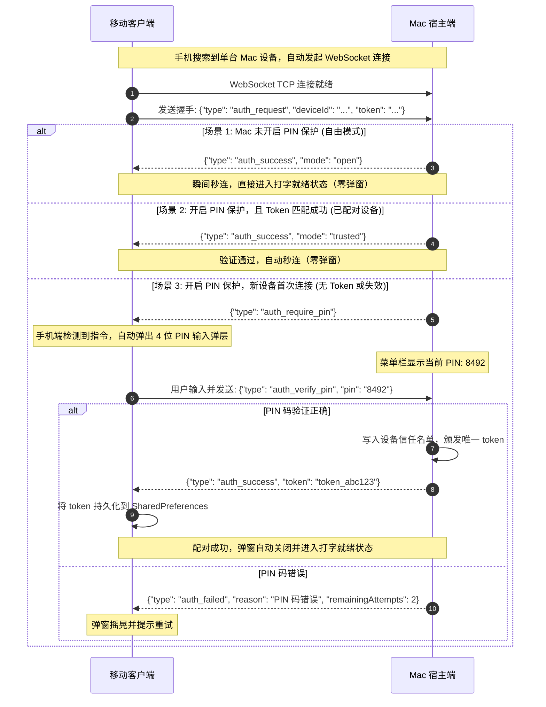

# PRD-07: 设备安全配对与PIN码鉴权 (规划中)

| 文档版本 | 状态 | 对应模块 | 负责人 |
| :--- | :--- | :--- | :--- |
| v1.0.0 | 📋 规划中 / 设计就绪 | `mac/` (Auth Gate), `mobile/` (Pin Dialog) | Vocal 团队 |

---

## 1. 功能概述与价值

- **功能概述**：在局域网内提供**可配置开启的 PIN 码安全保护机制**。
  - **当 Mac 未开启 PIN 保护时**：手机搜索到单个设备直接无感自动关联，零打扰极速使用；
  - **当 Mac 开启 PIN 保护时**：新设备首次连接自动弹出 4 位 PIN 码输入框，验证成功后下发长期凭证 (Token)；后续日常连接**自动免密秒连**，无需重复输码。
- **解决痛点**：在办公室、公共咖啡厅等开放共享局域网中，防止他人扫描到 Vocal 宿主端并误连打字，保障输入安全与设备排他性。

---

## 2. 功能详情列表

| 编号 | 详细功能项 | 运行端 | 规则与行为描述 |
| :--- | :--- | :--- | :--- |
| **7.1** | **PIN 保护全局开关** | Mac 宿主端 | 菜单栏提供勾选开关：`[✓] 启用 PIN 码保护`。默认为关闭（自由连接），用户可随时一键切换。 |
| **7.2** | **动态/静态 PIN 码展示** | Mac 宿主端 | 开启保护时，菜单栏显示当前有效 PIN 码（如 `PIN: 8492`），支持点击一键重置刷新。 |
| **7.3** | **单设备自动弹窗交互** | 移动端 | 搜索到唯一设备发起连接后，若服务端返回 `auth_require_pin`，客户端**自动弹出 4 位数字输入框**并聚焦第一格，体验无缝流畅。 |
| **7.4** | **首次配对与 Token 颁发** | 双端 | 客户端提交 PIN 码验证通过后，Mac 生成高强度随机 `device_token` 返回客户端，双端建立信任绑定并本地持久化。 |
| **7.5** | **日常免密秒级重连** | 移动端 | 客户端再次发起连接时，在握手阶段附带本地已保存的 `token`，Mac 校验合法后直接 `auth_success` 秒连，不再弹窗。 |
| **7.6** | **鉴权前指令安全门禁** | Mac 宿主端 | 在连接未完成鉴权前（握手阶段），服务端拦截丢弃所有 `text` 注入指令，防止未授权打字。 |
| **7.7** | **暴力破解限频防护** | Mac 宿主端 | 单个 IP 连续输错 3 次 PIN 码后，服务端主动断开连接并冷却拉黑 30 秒。 |
| **7.8** | **已配对设备管理与解绑** | Mac 宿主端 | 菜单栏提供“已信任设备列表”，支持一键清除某台手机信任或重置所有配对。 |

---

## 3. 业务与交互流程 (Mermaid)



---

## 4. 通信与协议数据规范

### 4.1 客户端握手请求 (Client -> Host)
```json
{
  "type": "auth_request",
  "deviceId": "550e8400-e29b-41d4-a716-446655440000",
  "deviceName": "iPhone 15 Pro",
  "token": "stored_token_string_or_empty"
}
```

### 4.2 服务端请求输入 PIN 码 (Host -> Client)
```json
{
  "type": "auth_require_pin"
}
```

### 4.3 客户端提交 PIN 码验证 (Client -> Host)
```json
{
  "type": "auth_verify_pin",
  "pin": "8492"
}
```

### 4.4 鉴权成功报文 (Host -> Client)
```json
{
  "type": "auth_success",
  "token": "d7a8f9c0e1b23456789a"
}
```

### 4.5 鉴权失败报文 (Host -> Client)
```json
{
  "type": "auth_failed",
  "reason": "INVALID_PIN",
  "remainingAttempts": 2
}
```

---

## 5. 存储与兼容性设计

1. **Mac 端持久化**：
   - 信任列表保存在 `~/.vocal_trusted_devices.plist` 或用户偏好设置，结构为字典映射：`deviceId -> { tokenHash, deviceName, lastPairedAt }`。
2. **向后兼容性 (Critical)**：
   - 若 Mac 处于“未开启 PIN 保护”状态，即使客户端版本较旧未发送 `auth_request`，收到纯文本或标准打字 JSON 时依然正常打字，绝不报错断开。
